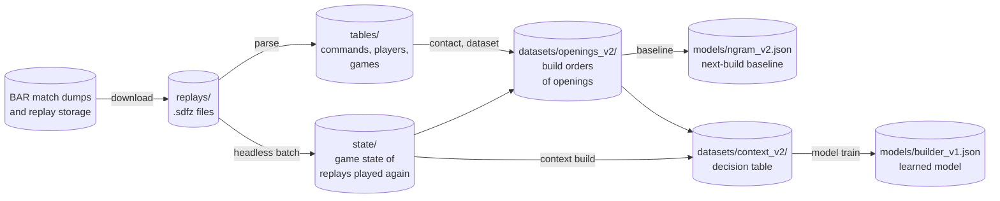
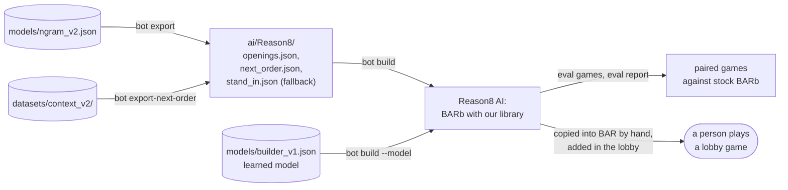

# Reason8

An AI for
[Beyond All Reason](https://github.com/beyond-all-reason/Beyond-All-Reason)
(BAR) that learns to play from publicly available replays of human games.

> **Status:** early proof of concept. The bot plays human openings in team
> games and hands over to BARb; the first learned model plays as an option,
> deciding the next order of every idle builder during the opening. See the
> [issues](../../issues) and [milestones](../../milestones) for what's being
> worked on.

## Getting started

You need [uv](https://docs.astral.sh/uv/getting-started/installation/); it
installs the right Python (3.15) for you.

```sh
git clone https://github.com/nineinchnick/reason8.git && cd reason8
uv sync                       # create .venv with all dependencies
uv run pre-commit install     # run the checks on every commit
uv run pytest                 # run the tests
uv run reason8 --help         # every command
```

Getting the data (into the git-ignored `data/`, or `$REASON8_DATA_DIR`):

```sh
uv run reason8 download --limit 100   # match dumps, then 100 replays of the slice
tools/fetch-parser.sh                 # once: the pinned replay parser
uv run reason8 parse                  # data/replays -> data/tables
```

The downloader keeps one connection at about one request per second, never
fetches a file twice, and records every match's status in
`data/replays/manifest.parquet`. See [`dataset.md`](docs/reference/dataset.md)
for the selection and [`replay-format.md`](docs/reference/replay-format.md)
for the parsed output.

`parse` keeps the parsed replays as Parquet tables, one file per table and
day, and every pass over many games (`maps check`, `contact`, `dataset` and
the `analysis` commands) reads those tables.

## Commands

Everything runs as `uv run reason8 <command>`; `--help` on any of them says
more. [`workflows.md`](docs/reference/workflows.md) shows, for each usual
task, the commands in order and what each one talks to.

`download`
: Download the match dumps and the replays of the training slice, politely
  (`--limit N --since YYYY-MM-DD --until YYYY-MM-DD`, `--dry-run`;
  [workflow](docs/reference/workflows.md#getting-replays-and-match-data)).

`sync push|pull [replays|tables|matches|state|state-NAME]`
: Copy the data directory to or from the private S3 bucket
  (`--since YYYY-MM-DD --until YYYY-MM-DD` for some days, `--match`,
  `--dry-run`).

`parse [paths] --jobs N --out DIR --since D --until D --force`
: Parse replays into the Parquet tables (commands, selections, events, chat,
  map drawings, start picks, shares, statistics, players, games), the replays
  not parsed yet or all of them
  ([workflow](docs/reference/workflows.md#parsing-replays-into-tables)).

`header REPLAY`
: Print which engine, game version and map a replay needs.

`widgets`
: Read the user widgets each player had installed from the replays.

`make-fixture REPLAY DEST`
: Make the anonymised test fixture from a parsed replay in the tables.

`maps fetch`, `maps check`
: Fetch BAR's pinned map list; measure how far real starts are from the
  recommended start positions.

`headless setup|run|batch|list|state|tables`
: Fetch an engine, game and map; run a game or play back a replay headlessly;
  play many replays and keep their state; write a batch's replay list from a
  sample, in parts for several machines; summarise a state file; convert state
  files to Parquet tables
  ([workflow](docs/reference/workflows.md#re-simulating-replays-for-game-state)).

`cloud up|run|status|down`
: Re-simulate a batch of replays on EC2 spot instances: deploy the stack of
  the workers; queue the games of a list and start instances; see how far it
  is and what it cost so far; stop it ([reference](docs/reference/cloud.md),
  [ADR 0020](docs/decisions/0020-re-simulate-in-bulk-on-spot-instances.md)).

`contact`
: Measure first contact in re-simulated replays (`--report` prints the
  tables).

`dataset`
: Build the opening dataset from the tables of the parsed replays (`--stats`
  prints the tables;
  [workflow](docs/reference/workflows.md#building-the-opening-dataset)).

`baseline`
: Fit, score and save the counting baselines for the next build.

`context sample|build|check|measure`
: Draw the games the decision table is built from; build it from the orders of
  re-simulated games and their state; check the join; measure what the state
  adds
  ([workflow](docs/reference/workflows.md#building-the-decision-table-and-measuring-models-on-it)).

`bot export`, `bot export-next-order`, `bot build`
: Export the model's openings, and what the bot needs when the model decides
  builders' next orders, into `ai/Reason8`; build the Reason8 AI from BARb and
  `ai/Reason8`
  ([workflow](docs/reference/workflows.md#exporting-for-the-bot-and-building-it)).

`bot game`, `bot check`
: Write the start script of an 8v8 AI game; check from a replay and its log
  what the AI played
  ([workflow](docs/reference/workflows.md#running-a-headless-game-and-checking-it)).

`eval games|report|openings`
: Play paired 8v8 games against stock BARb; compare their economy; tell the
  bot's openings from human ones
  ([workflow](docs/reference/workflows.md#paired-evaluation-games)).

`analysis opening-shift|map-meta|apm|reactions|play-quality|orders`
: The measurements behind the research on balance patches, on the opening meta
  of each start position, on how many actions per minute people take, on how
  long they take to give an idle unit new orders, on scores of how well a
  player played the opening and on how many orders one action holds.

## Data storage

The shared copy of the data directory lives in a private S3 bucket; a local
`data/` is a working copy
([ADR 0016](docs/decisions/0016-download-and-store-the-data.md)). Raw replays
contain player names and are never published. Using the bucket is opt-in: ask
the maintainer for access, configure AWS credentials as usual (`aws configure`
or `aws login`), and name the bucket:

```sh
export REASON8_S3_URI=s3://<bucket>       # or pass --s3-uri to each command
uv run reason8 sync pull replays tables   # bucket -> data/
uv run reason8 sync pull tables --since 2026-11-01 --until 2026-11-08  # a week
uv run reason8 sync push                  # data/ -> bucket: every area
```

Replays, the tables of the parsed replays and state files are kept in daily
partitions by the day the match started
(`replays/date=2026-11-01/<name>.sdfz`), the same in `data/` and in the bucket
([`dataset.md`](docs/reference/dataset.md#data-layout)). `sync` copies files
that are missing or differ in size, merges the manifest and the parse index,
and never deletes anything. With the bucket configured, `reason8 download`
looks there before asking BAR's servers and uploads what it downloads from
them. Storing the whole first slice (about 175 GB of replays and about 64 GB
of tables) costs about $6 a month.

## The idea in one paragraph

Instead of hand-writing rules ("build 2 mexes, then a lab, then…"), we show a
model thousands of real games and train it to predict *what a good player does
next* in a given situation. This is called **imitation learning** (or
behavioural cloning). It's how AlphaStar's StarCraft II agent was bootstrapped
before it improved further through self-play. We start with the smallest
version of that idea that can actually be tested: **learn the opening for each
start position on a popular team map**, then have a bot play it in team games.

## How the model is built

From replays of human games to a person playing with the bot, in two parts.
Each box is data in the data directory or the repo, each arrow the `reason8`
command that makes it, or the step done by hand.

First the training data, from replays:



Then the bot, from the models, and the games it plays:



By default the bot plays whole human openings, picked for its start position
before the game. As an option, the first learned model decides what each idle
builder does next, from the game's state; without the model file a stand-in
that knows only the builder and the minute answers instead. The steps of that
path are below, each linked to the record that decides it;
[`workflows.md`](docs/reference/workflows.md) has the commands of each task.

**What the model answers**
: One question: *this builder has nothing to do; what does it do next?* A
  builder is anything that constructs: the commander, factories, construction
  units, build towers. The answer is a probability for every option: a unit or
  building to make, or a job (assist, reclaim, repair, resurrect). Where to
  build and how to fight stay with BARb
  ([ADR 0019](docs/decisions/0019-first-model-decides-each-builders-next-order.md)).

**Game state from replays**
: A replay file (`.sdfz`) stores the players' commands, not the state of the
  game. Each replay is played again in the engine without graphics, and a
  widget records the state as the game runs: resources, units, what is under
  construction, what each team sees
  ([ADR 0010](docs/decisions/0010-re-simulate-replays-headlessly-for-game-state.md)).

**Examples**
: Every order a player gave to a builder becomes one row of a table: the
  situation just before the order, and the order as the right answer. The
  situation is the model's input: the order before it, the map and start
  position, the game time, the team's economy, its units, the kind of builder
  the order is for, the team's build power and the player's rating
  ([ADR 0018](docs/decisions/0018-learn-from-orders-joined-with-the-state-before-them.md)).

**Model**
: Gradient-boosted decision trees. A tree is a chain of yes/no questions about
  the input; every new tree is fitted to correct the mistakes of the trees
  before it. Trees train in minutes, suit tables like this one, and are simple
  enough for the bot to evaluate with its own code. The inputs and the form of
  the answer do not depend on trees, so a neural network can take their place.

**Evaluation**
: Some games are held out and never trained on. On those: how often is the
  model's top answer what the player did, compared with simpler baselines
  ([ADR 0013](docs/decisions/0013-evaluate-on-held-out-games.md),
  [results](docs/results.md))? That number only selects candidates. What
  counts is how the bot plays: its economy at first contact, and whether its
  openings can be told from human ones
  ([ADR 0003](docs/decisions/0003-define-success-as-in-game-measures.md)).

**In the game**
: The trained trees are written to a data file that ships with the bot
  ([ADR 0007](docs/decisions/0007-ship-the-model-as-tables-in-a-barb-variant.md)).
  When a builder is idle, the bot computes the same inputs from the live game,
  evaluates the trees, removes the answers that builder can never carry out,
  and picks at random among the answers with a probability of at least 10%.
  When no answer reaches that, BARb decides. The model plays until the opening
  ends ([ADR 0012](docs/decisions/0012-end-openings-at-first-contact.md)),
  then BARb plays on
  ([`in-game.md`](docs/reference/in-game.md#when-the-model-decides)).

## Goals

- **A team player.** The first target is team games: on popular maps like
  Supreme Isthmus each start position has an established meta, and the bot
  should learn and recognise it. It should also cooperate: answer help
  requests during raids, join planned raids, and follow the team captain's
  requests.
- **Plays to the end.** Openings are only the start. 1v1 games are the main
  source for learning whole-game decisions, because one player makes every
  decision.
- **Human-like.** The bot plays under the same limits as people: only what it
  can see, human command rates (including bursts), reaction time and limited
  attention. It should win by decisions, not by speed or extra information.
- **Grows inside BARb.** BARb, the AI that ships with BAR, already plays full
  games. Reason8 replaces its decisions one layer at a time (openings → macro
  → production), so the bot can always finish a game.

The first milestone succeeds when, on Supreme Isthmus, a classifier cannot
tell the bot's openings from human ones at the same position, and its economy
at first contact is at least stock BARb's
([ADR 0003](docs/decisions/0003-define-success-as-in-game-measures.md)).

## Roadmap

**1. PoC: learned openings**
: Team bot that plays the opening for its start position, predicted from
  replays; BARb takes over after

**2. Learned macro (1v1)**
: The model decides what to build for the whole game from game state recovered
  from replays; BARb runs production and army

**3. Learned production**
: Unit mix chosen from scouted information; team communication

**4. Beyond imitation**
: Offline RL on replays, then self-play, still within the human-like limits

Army control and unit micro stay with BARb until there's a reason to change
that.

### Out of scope (for now)

PvE modes (Scavengers, Raptors) and free-for-all games.

## Where the data comes from

[`data-processing`](https://github.com/beyond-all-reason/data-processing) public dumps — e.g. `https://data-marts.beyondallreason.dev/matches.parquet`
: Match metadata, rebuilt twice a week: map, game type, winner, duration, game
  version, player skill (OpenSkill), and `replay_file_name`.

BAR public object storage — `https://storage.uk.cloud.ovh.net/v1/AUTH_10286efc0d334efd917d476d7183232e/BAR/demos/<replay_file_name>`
: The replay files themselves. The replay site notes downloads *may be expired
  if older than a year*.

[`sdfz-demo-parser`](https://github.com/beyond-all-reason/demo-parser) (used by [bar-lobby](https://github.com/beyond-all-reason/bar-lobby))
: Parses `.sdfz` into JSON: header, players, end-of-game stats and the packet
  stream, including **build commands resolved to unit names**.

`https://api.bar-rts.com/replays`
: The replay search API bar-lobby uses (`?players=…&limit=…&page=…`,
  `/replays/<id>`).

Tournaments, leagues and casts
: A smaller hand-picked set of expert games (Alpha Cup, weekly leagues,
  YouTube casts), used for evaluation and extra weight.

### An important caveat about replays

BAR runs on the Recoil engine, which uses *lockstep* simulation: a replay
records **player commands**, not the game state. Build orders are visible
directly in the commands, but a command is an intention: builds can be
cancelled or re-queued, and the replay does not say what the player had or
what they answered. To know "what the map looked like" at minute 7 you have to
re-run the replay through the engine; models learn each decision with that
context
([ADR 0005](docs/decisions/0005-learn-decisions-with-their-context.md)).
[`state-extraction.md`](docs/research/state-extraction.md) shows how to
recover the state with a headless engine and what it costs. The decision table
joins the opening orders with the state just before each, and
[`context.md`](docs/research/context.md) measures what the state adds to
predicting the next build: a few points, mostly from the team's economy and
its own units.

### Game versions

BAR is rebalanced every few weeks, so openings from old versions could be
wrong today. Measured on Supreme Isthmus, a year of balance patches moved
openings less than sampling noise, so the dataset keeps its whole time window
across patches, records the version and patch era of every game, and models
record the versions they were trained on and check them when loaded. See
[`game-versions.md`](docs/research/game-versions.md) for the patches, the
measurement and the routine after a patch, and
[ADR 0015](docs/decisions/0015-train-across-balance-patches.md) for the
policy.

### Map meta

BAR's map metadata recommends start positions per map, each with a role
(front, tech, air, sea), and the game shows them before the start. On the
slice maps 97 to 99% of players start on one. `reason8.game.positions` gives
every player of a replay that position, from the game's own lobby options or
from the map list fetched by `reason8 maps fetch`: sixteen positions on an 8v8
map, eight per side. Supreme Isthmus has seven recognisably different openings
per side; All That Glitters and Rosetta have three (front, tech, air). The
meta is strongest in the first factory and loose in the exact build order. The
start a replay records is the player's last pick, which the game may have
refused: 1.9% of players started at another position, and the opening dataset
leaves out the 2.4% of openings whose first buildings are away from the start
([`start-positions.md`](docs/research/start-positions.md)). See
[`maps/`](docs/research/maps/README.md) for the positions, the sources and the
numbers per map, and
[ADR 0011](docs/decisions/0011-take-positions-from-the-map-metadata.md) for
how positions are defined.

### Opening dataset

`reason8 dataset` turns the parsed replays into the training data: every build
order a player gave until their units were first hit by the enemy, and at most
the first 8 minutes, with the player's position, faction, skill and result and
the game's version, split by game into train, validation and test. After first
contact orders answer raids and losses that the replay's commands do not show;
when it happens is measured on re-simulated replays
([`first-contact.md`](docs/research/first-contact.md)): 2 to 4.5 minutes into
the game at front positions, and not within 8 minutes at most tech positions.
See [`openings-dataset.md`](docs/reference/openings-dataset.md) for the
columns and the numbers, and
[ADR 0012](docs/decisions/0012-end-openings-at-first-contact.md) for where an
opening ends and how games are split. Counting baselines that predict the next
build set the bar for every later model: [`results.md`](docs/results.md),
measured as in [ADR 0013](docs/decisions/0013-evaluate-on-held-out-games.md).

### Actions per minute

The bot acts no faster than people of the skill it plays at. Counted the way
BAR counts APM, a typical player clicks 13 actions a minute, 36 with the
commands their widgets send; skill doubles that, while short bursts hardly
change with it. See [`apm.md`](docs/research/apm.md) for the measurements and
[ADR 0008](docs/decisions/0008-play-under-human-like-limits.md) for the limits
per skill band.

## Compute

Training and headless simulation run **locally first**
([ADR 0016](docs/decisions/0016-download-and-store-the-data.md)). Batches of
thousands of replays can also run on EC2 **spot instances** that take the
games from a queue and write their state to the bucket, and that terminate
themselves when the queue is empty (`reason8 cloud`,
[ADR 0020](docs/decisions/0020-re-simulate-in-bulk-on-spot-instances.md)).

The bot is judged in games: `reason8 eval games` plays Reason8 and stock BARb
in paired 8v8 games, many at a time, and `reason8 eval report` compares their
economy at first contact
([ADR 0003](docs/decisions/0003-define-success-as-in-game-measures.md)). A
comparison is 60 games and takes about 20 minutes here; memory, about 6 GB a
game, decides how many run at once. See
[`evaluation.md`](docs/reference/evaluation.md) for the harness, the A/A test,
the first results and the costs.

## Related work

- **BARb** — the AI that ships with BAR, built on
  [CircuitAI](https://github.com/rlcevg/CircuitAI).
- **[Apex](https://github.com/apexearth/bar-ai)** — a BARb fork where small
  neural nets adjust a build "market", trained on AI-vs-AI games. It also has
  tooling to re-play replays headlessly and log game state, which is directly
  relevant to us. Reason8 differs by learning from **human** replays.
- **AlphaStar / AlphaStar Unplugged** (StarCraft II) — imitation from human
  replays, then offline RL; also the main lesson on human-like limits.
- See [`barb.md`](docs/research/barb.md) for how BARb works and where a
  learned model can hook in.
- See [`related-work.md`](docs/research/related-work.md) for what Apex changed
  in BARb, what it measured, and what we reuse or do differently.
- See
  [`builder-model-prior-work.md`](docs/research/builder-model-prior-work.md)
  for what prior work says about drift, skill as an input, action masking, map
  inputs and how hand-written AIs pick builder jobs, for the first learned
  model.
- See [`in-game.md`](docs/reference/in-game.md) for how a model's decisions
  get into a running game, and how to build and run the Reason8 AI headlessly.

## Being a good citizen

- Download replays politely (rate-limited, cached, never re-downloaded) — this
  is community-funded infrastructure. `reason8 download` does this and stops
  when the server answers 429 or 503.
- BAR repos have an AI usage policy (`AI_POLICY.md`); follow it if
  contributing upstream.
- Player names in replays are personal data — the training data we publish
  should be anonymised.
- Ask BAR maintainers and tournament organisers before bulk downloads or
  publishing derived datasets.

## Layout

```
reason8/              # the Python package and the `reason8` command (cli.py)
  data/               #   match dumps and the slice, downloads, the S3 bucket, sync
  replays/            #   reading .sdfz files, parsing them into tables, reading the tables
  game/               #   game versions and balance patches, map metadata, positions
  headless/           #   headless engine runs, the state export widget, start scripts
  openings/           #   opening extraction, first contact, the opening dataset
  models/             #   next-build baselines and their evaluation
  bot/                #   building and checking the Reason8 AI
  evaluation/         #   paired games between the AIs and their comparison
  analysis/           #   measurements behind the research docs
ai/Reason8/           # in-game side: a BARb variant (AngelScript, Lua, JSON)
tools/                # fetch-parser.sh: the pinned sdfz-demo-parser
tests/                # mirrors reason8/; fixtures/ holds an anonymised replay
notebooks/            # exploration of the match dumps
docs/
  decisions/          # architecture decision records, from the most fundamental
  research/           # studies and measurements behind the decisions
  reference/          # the data, its formats, and how-tos
  results.md          # model results
data/                 # local data — git-ignored
```

## License

GPL-2.0-or-later, the same as Beyond All Reason's code: you can use it under
version 2 of the GNU General Public License or any later version. The licence
text is in [LICENSE](LICENSE); see
[ADR 0002](docs/decisions/0002-license-the-project-gpl-2-0-or-later.md).
