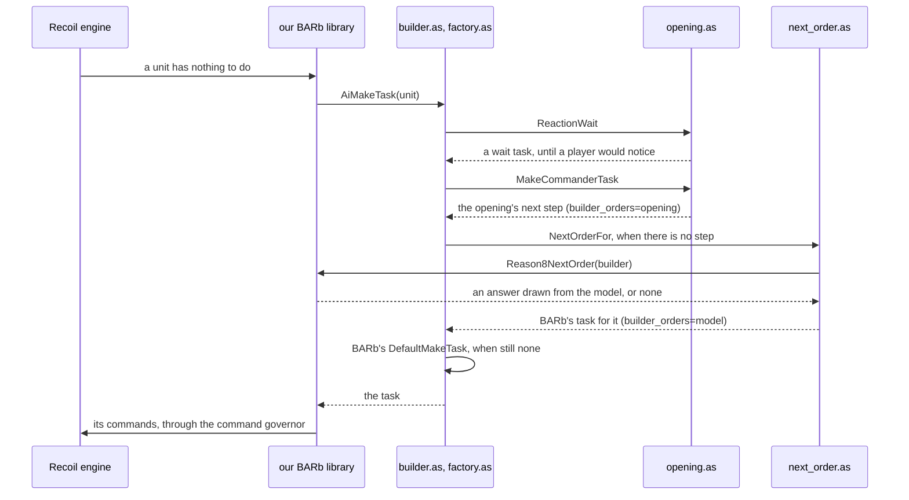
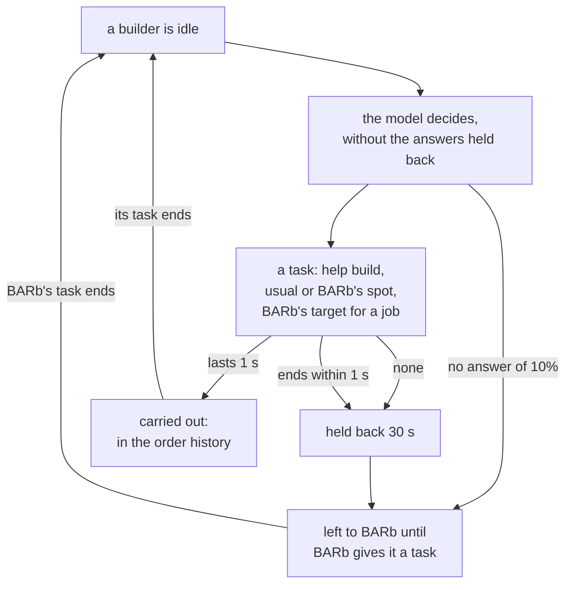
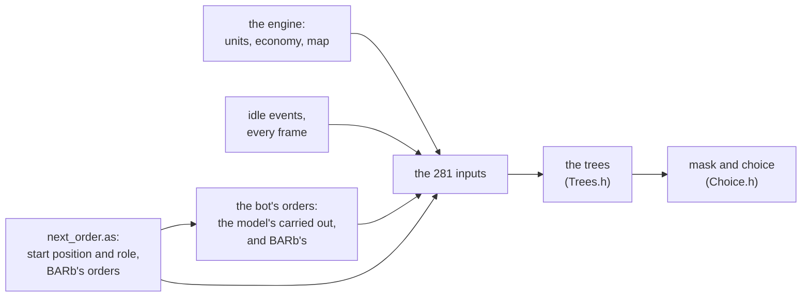

# How a trained model controls a bot in BAR

A model that predicts what a good player does next is only useful if its
predictions reach a running game. This document compares the ways to do that,
describes the one we built, and gives the measurements behind the choice. The
decision itself is
[ADR 0007](../decisions/0007-ship-the-model-as-tables-in-a-barb-variant.md).

Read [`barb.md`](../research/barb.md) first: it explains BARb, the AI that
ships with BAR, and the scripts mentioned here.

## Summary

- **A BARb variant under its own short name works.** We build BARb's library
  ourselves, add the game's BARb scripts with hooks in two of them, and
  install it as the Skirmish AI `Reason8`. It loads next to stock BARb and
  plays against it headlessly. With the engine's own library instead, it needs
  no C++ build at all.
- **It plays a build order we give it.** The commander builds the listed
  structures in order and the first factory makes the listed units in order,
  by unit name. Then stock BARb takes over. Checked against what was really
  built in 11 games: the commander's part was complete and in order in all 11;
  the factory's part was in order in all 11 and complete in 10 (in one game
  the economy was too weak to finish it in time).
- **It plays the model's openings of its start position.**
  `reason8 bot export` writes five openings per map, position and faction from
  the next-build model, and the AI picks one of those whose position is
  nearest to its commander. In two 8v8 games every Reason8 team found its
  position; see
  [Learned openings in team games](#learned-openings-in-team-games).
- **The model can decide each builder's next order instead.** With the AI
  option `builder_orders=model` the opening table is not played: during the
  opening the bot, as one player, decides the next order for every unit with
  build power that has nothing to do, by consulting one model of the team's
  state, and extractors go to the metal spots players usually take
  ([When the model decides](#when-the-model-decides)). The model is the
  learned one of
  [ADR 0019](../decisions/0019-first-model-decides-each-builders-next-order.md):
  our library evaluates its trees and computes its inputs from the live game,
  the same inputs the decision table has, checked against the state export. In
  two 8v8 games it decided 93% and 86% of the orders; its economy at 8:00 is
  still weaker than the openings', so the option is off by default
  ([The learned model's orders](#the-learned-models-orders)).
- **The openings' model does not run inside the game.** For openings its
  output is known before the game starts, so it is exported to a data file and
  compiled into a script table.
- **Failures are silent.** A missing AI or a script error leaves the team
  standing still while the game runs on and exits normally. Every result has
  to be checked against the log and the replay, and there is a tool for it.
- **BARb is not human-like in how often it gives orders**: 40 to 700 commands
  a minute in the first five minutes, peaks of 1,100 to 3,200 a minute later,
  and up to 125 in one second. The scripts cannot change that; our build of
  its library can.
- **Our build of BARb's library keeps the bot within a strong player's action
  budget and lets the scripts read the game as it is.** A command governor
  holds the commands that do not fit the budget of
  [ADR 0008](../decisions/0008-play-under-human-like-limits.md) and sends them
  later in order, so nothing is lost and BARb keeps playing; the scripts read
  the current wind, the team's economy and its standing units. See
  [Our BARb library](#our-barb-library).
- **Past the tables, our own build of BARb's library was the route that covers
  everything.** A script-to-widget bridge also works, but only adds a little
  state and cannot limit commands. See [Past the tables](#past-the-tables).

## The options

Each option is judged on the same points: how a decision gets into the game,
how long that takes, what the bot can see, how it is installed and whether it
works in a normal lobby, and how it is tested headlessly. "Measured" means we
ran it; everything else was read from the engine, the game or the lobby
source.

### 1. BARb variant with tables generated offline (built)

How decisions get in
: The model's predictions are written to a data file before the game. The
  build turns the file into an AngelScript table inside the AI's folder. Hooks
  in BARb's builder and factory scripts play the table. *Measured.*

Latency
: None at decision time: a table lookup inside the AI's own update.

What it sees
: Whatever BARb's scripts are given (listed below): own economy, own units,
  map name, side, positions, sums about the enemy. Enemy information goes
  through BARb's own tracking, which uses line of sight and radar unless the
  `cheating` option is on ([`barb.md`](../research/barb.md)); our options
  leave it off. An opening table needs none of it.

Install and lobbies
: One folder, `AI/Skirmish/Reason8/<version>/`, in the engine folder or in the
  data folder. *Measured for both, headlessly.* A Skirmish AI runs on the
  computer of the player who added it, and its orders travel as ordinary
  network commands, so only that player needs the folder; the game archive is
  not changed. Details and what is still untested are under
  [Installing](#installing-it-in-a-real-game).

Headless test
: `reason8 headless run` with a start script that names the AI. *Measured:* 30
  s of wall time for a 5-minute game.

Limits
: Only decisions that are known before the game, or that depend on the little
  the scripts can see. The scripts have no file or network access.

### 2. BARb variant that asks a model during the game

How decisions get in
: Two routes. (a) The script calls Lua with `ai.CallUI(text)`; a widget on the
  same computer answers with a string. *Measured: the call and the answer
  arrive, and an outside process can answer through files.* (b) A C++ build of
  the AI (CircuitAI) that runs the model itself or talks to another process,
  which is what Apex does ([`related-work.md`](../research/related-work.md)).
  *Measured: it builds, loads and plays.* Both are in
  [Past the tables](#past-the-tables).

Latency
: (a) The call is synchronous and in-process. The widget's log line and the
  script's log line with the answer were 14 microseconds apart. The game waits
  for the answer, so a slow model would freeze it; a real bridge has to ask in
  one update and read the answer in a later one. (b) In-process.

What it sees
: (a) The script can only send what it sees itself; the widget could add what
  the local player's interface sees. (b) Everything the AI interface offers.

Install and lobbies
: (a) The AI folder plus a widget on the same computer. BAR runs user widgets
  in a sandbox that removes `socket` (*measured: `socket` is `nil`*) and
  allows files only under `LuaUI/Config/` and `LuaUI/Widgets/` (*measured:
  anything else is refused*). So a user widget reaches another process through
  files only. The host can also switch user widgets off (`allowuserwidgets`,
  or anonymous mode). (b) One folder, but a library to build for Windows and
  Linux against each engine release.

Headless test
: Same runner; `--widget` installs the widget.

Limits
: (a) In one of three early runs that had a test widget installed, the engine
  stopped advancing after frame 289 and had to be killed; the two later runs
  with a widget finished. The cause is unknown, so a bridge needs a timeout.
  The test widgets and the script changes are not in the repo.

### 3. Own native Skirmish AI

How decisions get in
: A library the engine loads through its C interface, like BARb. It is
  ordinary native code, so it can embed a model runtime or open a socket or
  pipe to a Python process. The engine ships a minimal example, `NullAI`
  (`AIInfo.lua`, `AIOptions.lua` and one library).

Latency
: In-process; a second process adds one round trip per decision.

What it sees
: The AI interface: own units and resources, the map, and enemy units as the
  team sees them, unless cheats are switched on. *By the interface's design;
  not checked here.*

Install and lobbies
: Like option 1: a folder under `AI/Skirmish/`, needed only by the player who
  adds the bot. A second process would have to be started and found on that
  player's computer too.

Headless test
: Same runner.

Limits
: Everything BARb does (pathing, placement, threat maps, army control) has to
  be written again or done without. That is against
  [ADR 0006](../decisions/0006-build-on-barb-and-replace-its-decisions-layer-by-layer.md).
  The library has to be built for each platform and engine version.

### 4. Lua AI (a gadget in the game)

How decisions get in
: BAR's own Lua AIs (`SimpleAI`, `ScavengersAI`, `RaptorsAI`, listed in the
  game's `luaai.lua`) are synced gadgets inside the game archive, for example
  `luarules/gadgets/ai_simpleai.lua`. The model would be Lua tables or Lua
  code in such a gadget.

Latency
: Runs inside the simulation on every player's computer, so it must be
  deterministic and cheap. No sockets, no files, no other process.

What it sees
: Everything. Synced code is not limited to a team's line of sight, so the
  limits of [ADR 0008](../decisions/0008-play-under-human-like-limits.md)
  would be self-imposed.

Install and lobbies
: It has to be in the game archive that every player runs. That means getting
  it merged into BAR, or a modified game, which normal lobbies do not host.

Headless test
: Same runner, with `ShortName=<Lua AI name>` and no library. *Not tried.*

Limits
: Not installable by one player. Ruled out for the proof of concept.

### 5. Widget that plays a player's slot

How decisions get in
: A widget is unsynced Lua on one player's computer. It gives orders for that
  player's own team, so the bot occupies a human slot, not an AI slot.

Latency
: Per frame, in-process.

What it sees
: Exactly what that player sees, enforced by the engine. This is the only
  option that is human-like in what it sees by construction. *Not checked
  here.*

Install and lobbies
: A file in the player's widget folder, but one game client per bot. BAR's
  sandbox stops user widgets from giving orders when the host switches off
  `allowunitcontrolwidgets`, and removes `socket`, so the model has to be Lua
  or sit behind files. *Read in the game's `luaui/barwidgets.lua`; both mod
  options are on by default.*

Headless test
: Possible in principle (our state export is a widget), but the runner would
  have to join as a player. *Not tried.*

Limits
: No AI slot, so no "add a bot" in the lobby; a whole client per bot; and
  everything BARb does would have to be written in Lua.

## What we built

The AI lives in [`ai/Reason8`](../../ai/Reason8):

`AIInfo.lua`, `AIOptions.lua`
: The AI's identity (short name `Reason8`, version `0.1`) and its options. Two
  defaults differ from BARb's: `game_config` is off, because the game archive
  has no scripts for this AI, and the only profile is `hard`.

`openings.json`
: The openings, as data, written by `reason8 bot export` from the next-build
  model ([`results.md`](../results.md#using-it-in-the-game)). For each side,
  map and start position, five openings (`variant` 0 to 4, the one the model
  finds most likely first): where the position's players start, the structures
  the commander builds with where the human placed each (`places`), and the
  first units of its first factory, by unit name. An opening whose first three
  places are all more than 700 units from the position's start is not exported
  for it. A separate `tasks` map says which BARb task type builds each
  structure. An opening without a map is played on any map, by side only; the
  tests use a file of deliberately unusual ones, so that a game shows at once
  whether they were played.

`script/hard/reason8/opening.as`
: The logic, about 400 lines of AngelScript. It finds the position of the AI's
  side and map whose start is nearest to the commander, picks one of its
  openings at random, of those with one of the first three places within 700
  units of the commander (in lobby games with fewer players than positions the
  bot starts hundreds of units from a position's start), and gives the
  commander one build task per step and the factory one task per unit, moving
  on when a task is done and trying again, after a pause, when it fails.

`next_order.json`
: What the bot uses when the model decides builders' next orders
  ([When the model decides](#when-the-model-decides)), written by
  `reason8 bot export-next-order`: the usual order of metal spots per map and
  start position, and BARb's task type for every structure.

`stand_in.json`
: The stand-in model's table, written by the same command: how often players'
  builders of each unit got each answer in each minute. The AI plays it when
  it was built without the learned model's file.

`script/hard/reason8/next_order.as`
: The script side of the model's orders: it carries out the order our library
  chooses for an idle builder with BARb's tasks, or leaves it to BARb.

`script/hard/manager/builder.as`, `factory.as`
: Copies of BARb's two scripts with added calls into `opening.as` and
  `next_order.as`, marked `Reason8:`.

`script/hard/main.as`
: A copy of BARb's main script, unchanged.

`base.json`
: The SHA-256 of the stock scripts those copies were made from.

```json
{
  "tasks": {
    "armlab": "factory",
    "armmex": "mex",
    "armwin": "energy"
  },
  "openings": [
    {
      "side": "armada",
      "map": "Supreme Isthmus v2.1",
      "position": "P1",
      "start": [
        681,
        7376
      ],
      "candidates": 1965,
      "log_likelihood": -9.262,
      "commander": [
        "armmex",
        "armmex",
        "armmex",
        "armwin",
        "armwin",
        "armwin",
        "armwin",
        "armlab"
      ],
      "factories": {
        "armlab": [
          "armck",
          "armrectr",
          "armck"
        ]
      },
      "dropped": {
        "after the commander's last structure": 4
      }
    }
  ]
}
```

(Shortened: the opening has 30 commander steps and six factory units.)
`candidates` is how many human openings the export scored for the position and
`log_likelihood` the model's score of the one chosen; `dropped` counts what
the AI cannot play (see [`results.md`](../results.md#using-it-in-the-game)).

`reason8 bot build` puts the AI folder together from four sources:

1. the engine's own `AI/Skirmish/BARb/stable/`: the files that come with
   BARb's library;
2. our build of BARb's library in place of the engine's (see
   [Our BARb library](#our-barb-library));
3. the installed game's `luarules/configs/BARb/stable/`: BARb's scripts and
   configs for the `hard` profile, read from the game package;
4. `ai/Reason8`, on top, with `openings.json` turned into
   `script/hard/reason8/opening_table.as`. Each opening's steps and factory
   units are one string there, decoded only for the opening played: 480
   openings as nested script arrays made each Reason8 AI take minutes to
   compile. `next_order.json` is turned into
   `script/hard/reason8/next_order_table.as`, with the role of each start
   position from the map list, and `stand_in.json` into the stand-in's
   `reason8/stand_in.txt`, which our library reads.
   `script/hard/reason8/live_state.as` is generated for the library installed;
5. the learned builder model (`--model`, by default `builder_v1` in the data
   directory's `models/`), copied to `reason8/builder_model.json` when it is
   there. It is built from players' data and never committed;
   `reason8_build.json` records its name, size and SHA-256.

It stops when a stock script that we replace no longer has the recorded hash,
because our copy would silently drop the game's change.

### Our BARb library

The library is CircuitAI at the commit the engine pins for BARb, with our
files in [`ai/native`](../../ai/native), built by
[`ai/native/build.sh`](../../ai/native/build.sh) (see
[Our own build of BARb's library](#c-our-own-build-of-barbs-library) for the
toolchain and the pinned downloads).

Building it

: `reason8 bot build` runs `build.sh` for the tag and platform of the engine
  it installs into, in `<data dir>/native/<tag>/` for Linux and
  `<data dir>/native/<tag>-windows/` for Windows (`--library-cache` for
  another place). The first build takes 5 to 7 minutes on four cores (`JOBS`,
  default 4); after that the build is reused until a file in `ai/native`
  changes, and a change rebuilds in seconds. `build.sh` writes
  `reason8_library.json` next to the library: the platform, the engine tag and
  commit, and the SHA-256 of the library and of `ai/native`.
  `--library <folder>` takes a build made elsewhere (the folder, or the
  `libSkirmishAI.so` or `SkirmishAI.dll` in it); it must be for the engine's
  tag and platform.

Platforms

: Linux x86-64 (`libSkirmishAI.so`) and Windows x86-64 (`SkirmishAI.dll`). The
  platform is the engine's: an engine whose BARb has `SkirmishAI.dll` gets the
  Windows library. Both are built on Linux x86-64: Linux with the toolchain
  below, Windows with `build.sh --platform windows`, which cross-compiles in
  BAR's own Windows build image, run by podman or docker without network (see
  [Windows](#c-our-own-build-of-barbs-library) under Past the tables). Where
  neither can be built, `--library stock` installs the engine's own library:
  the AI plays its openings, without the command budget, and the live state
  reads as unknown (-1): the scripts do not learn of the team's first contact.

Engine version

: The library is built for one engine tag. `reason8 bot build` stops when the
  build it would use is for another tag, and the library logs, when it starts,
  the engine it was built for and the one it runs in
  (`Reason8 library: team 0: built for engine 2026.09.03, running in engine 2026.09.03`),
  and an `engine mismatch` line when they differ. `build.sh` knows the commit
  of one tag; another needs `--engine-commit`.

The command governor

: Every command the library sends goes through one engine callback
  (`Engine_handleCommand`, see [A command governor](#a-command-governor)). The
  governor counts each unit command as an action the way a player's is counted
  ([ADR 0008](../decisions/0008-play-under-human-like-limits.md)), and holds a
  command that would take an action the 30-40 band's budget has no room for.
  On every frame, before the AI's own commands, it sends what fits, oldest
  first: once an action of one kind of order fits, every held command of that
  kind goes in the same frame, which by the counting rule is the same action;
  each other kind needs an action of its own. Commands to a unit in the frame
  it was finished (the settings BARb gives a new unit) take no action, as in
  BAR's own APM gadget. A unit with a held command has its later commands held
  behind it. A new order to a mobile unit given without shift replaces the
  held orders to that unit, as it would replace them a moment after they
  arrived (a factory's orders add to its queue, so they never replace each
  other). Past 1,024 held commands the oldest is dropped and counted. Spending
  is paced: each window also has a bucket of a quarter of its cap that refills
  at the rate that spends the rest evenly, so a busy AI acts every second or
  two instead of spending a window's cap at once and then waiting. The logic
  is in `Budget.h`, which knows nothing of the engine; `test_budget.cpp` tests
  it and `build.sh` runs the test with the same compiler before every build.

Its log

: One line per team and minute, and the action frames of that minute:

  ```
  Reason8 governor: team 0: mode defer, band 30-40
  Reason8 governor: team 0: minute 1: seen 89, sent at once 49, sent later 35, deferred 40, collapsed 5, dropped 0, failed 0, actions 31, worst delay 58 frames, held 0
  Reason8 governor: team 0: minute 1 action frames: 25 150 651 673 691 ...
  Reason8 governor: team 0: total to frame 9000: seen 877, sent at once 241, sent later 533, deferred 636, collapsed 97, dropped 0, failed 10, actions 234, worst delay 59 frames, held 6
  ```

  `collapsed` commands were replaced by a newer order while held, `failed`
  ones were held and then refused by the engine (the unit was gone), `held` is
  what was still waiting when the game ended. The AI option `command_budget`
  (in the start script's `[OPTIONS]` of the AI) switches it to `count` (log
  only) or `off`; `defer` is the default.

The live state

: Functions for the scripts, read from the engine when called:
  `Reason8CurrentWind()`, `Reason8Resource(resource, what)` with `metal` or
  `energy` and `current`, `storage`, `income`, `expense` or `pull`,
  `Reason8UnitCount(name)` (the team's finished units of that name) and
  `Reason8Standing()` (all of them by name). Two more report the team's first
  contact, kept from the engine's unit-damaged events as they arrive:
  `Reason8FirstContactFrame()`, the frame a unit of the team other than a
  scout was first damaged by an enemy unit (-1 before that), and
  `Reason8FirstContact()`, what was hit by what (`armck by corak`). A hit
  counts when the attacker is an enemy unit, or a weapon whose unit the AI
  cannot see (an ally's it always sees); damage with no unit behind it
  (debris, falling) does not. The scouts are those of
  [ADR 0012](../decisions/0012-end-openings-at-first-contact.md). The scripts
  call them through `live_state.as`, which `reason8 bot build` generates for
  the library it installs: with the stock library they return -1 and an empty
  string, so the same scripts compile with either. The opening script logs
  them at every commander step and every 30 s:

  ```
  Reason8 opening: team 0: state at frame 1761: wind 17.1668, metal 349.494 of 1150 +4.30268 -6.96429, energy 23.3591 of 1101 +64.4555 -78, standing armcom 1, armflea 2, armlab 1, armmex 1, armwin 2
  ```

The next order

: Functions for the scripts with which the bot decides the next order of an
  idle builder ([When the model decides](#when-the-model-decides)):
  `Reason8ModelOrders()` (the AI option `builder_orders` is `model`),
  `Reason8NextOrder(builder)`, which consults the model, masks, chooses, logs
  the decision and returns the order or nothing,
  `Reason8OrderFailed(builder, order, reason)`,
  `Reason8OrderEnded(builder, order, done, frames)` (the end of an order's
  task, and whether it ended at once), `Reason8TaskInProgress(builder)` (the
  task BARb reevaluates), `Reason8HelpBuild(builder, unit)`,
  `Reason8BarbTask(builder, job)`, a task for a job with the target BARb's
  tasks choose, `Reason8BarbSpotTask(builder, unit, spot)`, an extractor on
  BARb's next free spot, `Reason8SpotOpen(spot)`, `Reason8SpotUsable(spot)`,
  `Reason8BarbOrdered(builder, task)` (BARb gave a builder left to it a task:
  an order for the model's history) and `Reason8SetStart(position, role)`.
  What became of each order is kept in `OrderBook.h`. The model sits behind
  one interface (`AnswerModel` in `Model.h`): given the builder the order is
  for, a probability per answer. The learned trees are read and evaluated by
  `Trees.h`, their inputs computed in `NextOrder.cpp` with the rules of
  `ModelInputs.h`; the mask and the choice are in `Choice.h`. The parts
  without the engine have tests that `build.sh` runs before every build:
  `test_next_order.cpp` (mask, choice, stand-in, order history, the export's
  rounding, orders carried out and held back) and `test_trees.cpp` (every
  decision of the builder model's test vectors,
  [`builder-model.md`](builder-model.md#test-vectors)).

Our changes to BARb's own files

: A few lines in `AIExport.cpp` (install and release the governor, call it on
  every update and unit-finished event; pass each unit-damaged event to the
  live state; pass every update and each idle event to the next order, for the
  model's inputs) and four in `InitScript.cpp` (register the live state and
  the next order), as patches in `ai/native`; the rest is new files.

What it measured is in
[`command-governor.md`](../research/command-governor.md) and
[`evaluation.md`](evaluation.md#our-barb-library).

### How the hooks work

What happens when a builder or factory has nothing to do, in the order the
hooks ask (`builder.as`; `factory.as` is the same with `MakeFactoryTask`):



Commander
: `Builder::AiMakeTask` is called whenever a builder has nothing to do. For
  the commander, `opening.as` returns a task for the next step, created with
  BARb's own task functions (`TaskB::Common`, `TaskB::Factory`), so BARb still
  chooses the exact spot and handles the walk. `AiTaskRemoved` tells the
  script that the step finished or failed. After the last step the hook
  returns nothing and BARb's default takes over.

Extractors
: An extractor task needs one of BARb's metal spots. BAR publishes the map's
  spots as game rules (`mex_count`, `mex_x1`, `mex_z1`, ...), BARb reads them
  in that order, and scripts can read game rules, so spot `i` of the game is
  BARb's spot `i - 1`. For a `mex` step the script takes the free spot nearest
  to where the human player built that extractor and creates the task on it
  (`TaskB::Spot`). Without a known place, or without the game's spots, it asks
  BARb for its default task and accepts it only if it is an extractor of the
  ordered type; after the first three extractors BARb rarely offers one.

Placement
: Every step carries where the human player placed it (`places` in
  `openings.json`). The first try builds there, BARb choosing the exact site
  around it; when that fails, the next tries build next to the builder.

Reaction delays
: Every factory and builder of the AI, the opening's and BARb's, waits before
  its next task as long as a player of the 30-40 band takes to notice it
  ([ADR 0008](../decisions/0008-play-under-human-like-limits.md),
  [`reactions.md`](../research/reactions.md)). The hooks in `builder.as` and
  `factory.as` ask `opening.as` first: when a unit's batch of tasks is used
  up, it draws a delay for its kind (factory, builder, construction turret)
  and phase of the game from the table `reason8 bot export` writes, 60 s for a
  draw of "no answer", and gives the unit a wait task. A batch is how many
  tasks one look gives a unit, drawn around what players start between two
  idle events: about six units for a factory, one or two structures for a
  builder. Only a finished task uses up the batch, so a unit taking back a
  task it dropped, or the opening's own short waits, add no delay.
  `reason8 bot build --limits-only` builds the same AI without openings as
  `BARbLimited`, stock BARb under the same limits.

Hidden timers
: BARb's configs hold some units back (`since` in `behaviour.json`): the radar
  until 120 s, the light laser tower until 70 s. The script sets the unit's
  `sinceFrame` to 0 when an opening orders it earlier. *Measured:* the radar
  was ordered at second 28 and the laser tower at second 25.

Factory
: `Factory::AiUnitAdded` is called when a factory is finished; the script
  remembers the first factory the opening has units for. `Factory::AiMakeTask`
  is called whenever a factory has nothing to do, and the script returns a
  recruit task for the next listed unit, by name. BARb's own opener works in
  roles (RAIDER, SCOUT...); a recruit task takes a unit, so no mapping from
  units to roles is needed. One unit is queued at a time, so a task that BARb
  gives up on can be queued again without changing the order.

End of the opening
: `Main::AiUpdate`, which BARb calls once a second, asks `opening.as` whether
  the opening still applies. When it does not, the opening ends before its
  last step: the commander's current step is aborted, the factory finishes the
  unit it is making, and BARb decides for both from then on. See
  [When the opening ends](#when-the-opening-ends).

Log
: Every decision is logged with the prefix `Reason8 opening: team <id>:`, so
  the lines of several Reason8 teams in one game can be told apart.

```
Reason8 opening: team 0: side 'armada', map 'Supreme Isthmus v2.1', start 711 7215: position P1 (start 681 7376), opening 2 of 5, 30 commander steps, 1 factories
Reason8 opening: team 0: step 1 armmex: BARb's extractor task, frame 81
Reason8 opening: team 0: step 1: finished, frame 334
Reason8 opening: team 0: step 4 armwin: task queued, frame 1017
Reason8 opening: team 0: step 8: finished, frame 2768
Reason8 opening: team 0: factory armlab: will make armck armrectr armck armrectr armck armrectr, frame 2768
Reason8 opening: team 0: factory unit 1 armck: task queued, frame 2789
Reason8 opening: team 0: factory unit 1: done, frame 3520
Reason8 opening: team 0: opening ended at frame 12673, step: step 15 armnanotc not finished 111 s after it was queued; commander steps done 14 of 30, factory units done 31 of 36; BARb takes over
```

### When the model decides

With the AI option `builder_orders=model`, the opening table is not played.
Instead, during the opening, the bot decides the next order for every unit
with build power that has nothing to do (the commander, factories,
construction units, construction turrets and the others) by consulting one
model of the team's state, as
[ADR 0019](../decisions/0019-first-model-decides-each-builders-next-order.md)
decides. The bot is one player: it notices an idle builder and gives it
something to do, as a person does; the builder is what the decision is about,
not who makes it. The default, `opening`, plays the opening table as before.
The model's orders need our library; with the engine's own the option has no
effect.

The model

: The learned trees of ADR 0019, `reason8/builder_model.json` in the AI folder
  ([`builder-model.md`](builder-model.md)), read when the AI starts, once per
  process for all its AIs: 2.8 s and 14 MB in an 8v8 game, about 1.7 ms a
  decision. Without that file a **stand-in** answers: NOT the learned model,
  but a fixed table of how often players' builders of each unit got each
  answer in each minute of the opening window, measured on the training split
  of the decision table (`reason8 bot export-next-order`,
  `reason8/bot/next_order.py`, `stand_in.json`). It knows nothing of the game
  state. The library logs which model answers when the AI starts.

The inputs

: Computed from the live game for every decision, as the decision table
  defines them ([The model's inputs](#the-models-inputs)). The AI option
  `skill` sets the skill the model is told; empty, it is the 90th percentile
  of the training players' skill (43.9 for `builder_v1`), high but inside the
  range seen in training, as ADR 0019 asks.

The answer

: A unit to build, or a job without a target: `assist`, `reclaim`, `repair` or
  `resurrect`, as the decision table names them.

The mask and the choice

: The library removes the answers the idle builder can never carry out, by its
  unit definition as the game loaded it: units outside its build list, jobs
  its definition does not allow, and every job for a factory. It also holds
  back, for 30 s of game time, every answer this builder could not carry out
  (below). It rescales the rest to sum to one and draws among those of at
  least 10%, in proportion to their probabilities. What the team cannot afford
  stays possible.

Carrying it out

: What a player means by the order:

  - a unit, by a factory: a recruit task;
  - a structure of a type the team is building already: the builder helps
    build it instead of starting another, a factory wherever it is, any other
    structure within 600 of the builder (the distance within which BARb's
    builders assist a factory). It is not decided for again until that has
    ended;
  - an extractor: the next of the metal spots its position's players usually
    take, in the order they usually take them (`metal_spots` in
    `next_order.json`), skipping spots with an extractor on them, already
    ordered, in an ally's area (where BARb drops an extractor task at once) or
    further from the AI's own start than the farthest usual spot is from its
    position's start; a lobby game with fewer players than positions starts a
    team hundreds of units from the nearest position. When none is left, or
    the map has none, the free spot BARb would take for its own next
    extractor: the nearest open one, outside an ally's area, that the builder
    can reach safely;
  - any other structure: a build task next to the builder, BARb choosing the
    site;
  - a job: a task with the target BARb's own tasks choose for that job. To
    reclaim or resurrect, BARb's choice near a builder: the nearest reachable,
    safe feature within 20 to 60 s of its travel. To assist, a factory that
    wants help, else guarding the closest factory for a minute. To repair, the
    nearest of BARb's repair tasks. A construction turret takes the target
    BARb's turret task would in its reach: to assist, the unit under
    construction closest to finished; to repair, a damaged unit; to reclaim,
    the features in reach.

Carried out

: An order is carried out once its task has lasted a second, or once the
  builder is idle again after a build it finished sooner; only then does it
  enter the model's order history. BARb also asks the script for a task while
  it reevaluates the task a builder is on (`IBuilderTask::Reevaluate`); the
  model is not consulted then, and a model order's task goes on. A task that
  lasted and then ended, done or not (a guard that timed out, a build site
  BARb gave up), carried the order out; the model decides at the builder's
  next idle.

When it is left to BARb

: When no possible answer reaches 10%, none is possible, the model has none
  for the builder, or the order cannot be carried out, the builder is left to
  BARb until BARb gives it something to do; at the builder's next idle the
  model decides again. An order cannot be carried out when it cannot be given
  (no target for the job, no free metal spot, no task builds it) or its task
  ends within a second: unfinished, or a job done with nothing to do. That
  answer is then held back for the builder for 30 s, so that the model does
  not choose it again while nothing changed.



Until when

: The team's first contact or the end of the 8-minute opening window,
  whichever comes first, as for the opening
  ([When the opening ends](#when-the-opening-ends)); then BARb decides for
  every unit. The reaction delays and the command budget apply to every
  builder as before.

The usual order of metal spots

: For each map and position, the spots taken in at least a quarter of its
  training openings, in the order of the median rank at which an opening took
  each (rank 1 is the first spot it put an extractor on), from the extractor
  orders of `openings_v2`. Orders within 64 of each other are one spot. On the
  three maps of the slice, all 48 positions have one, with 4 to 25 spots.

Log

: Every decision is one line with the prefix `Reason8 next order: team <id>:`,
  and so is what came of it:

  ```
  Reason8 next order: team 2: the model decides the next orders of idle builders during the opening; the opening table is not played
  Reason8 next order: team 2: model builder_v1 (the learned trees) from reason8/builder_model.json: 28900 trees, 489020 nodes, 281 inputs, shared with an AI of this process; skill 43.894001 (the 0.9 quantile of training)
  Reason8 next order: team 2: map 'Supreme Isthmus v2.1', start 2155 11744: position P3 (start 2146 11801), role air, 4 usual metal spots
  Reason8 next order: team 2: frame 19: armcom 25947 commander: model chose armmex 0.99; 1 of 29 possible of 414 at 10% or more: armmex 0.99 armwin 0.01 armlab 0.00 armap 0.00 armsolar 0.00
  Reason8 next order: team 2: frame 19: armcom 25947 commander: inputs faction=Armada; map=Supreme Isthmus v2.1; position=P3; role=air; previous_1=<start>; builder_kind=commander; ...
  Reason8 next order: team 2: frame 19: armcom 25947: armmex on usual spot 1 of 4, BARb's spot 88 at 2280 11960
  Reason8 next order: team 2: frame 49: armcom 25947 commander: carried out armmex, chosen at frame 19
  Reason8 next order: team 2: frame 412: armcom 25947 commander: armmex ended done after 393 frames
  Reason8 next order: team 2: frame 1880: armcom 25947 commander: model chose armlab 0.52; 2 of 29 possible of 414 at 10% or more: armlab 0.52 armwin 0.28 ...
  Reason8 next order: team 2: frame 1880: armcom 25947: armlab: helps build the one the team is building
  Reason8 next order: team 2: frame 2350: armcom 25947 commander: cannot carry out reclaim: its task ended at once, unfinished; left to BARb
  Reason8 next order: team 2: frame 2379: armcom 25947 commander: BARb ordered armmex
  Reason8 next order: team 2: model orders ended at frame 8732, contact: first contact at frame 8702, armatlas by corveng; BARb takes over
  ```

  The first AI of the process to start reads the model
  (`read in 2.8 s, 13.7 MB` in place of `shared with an AI of this process`);
  without the file the line names the stand-in and says why. The inputs of
  every fourth decision of a team are logged: every name, every number but
  zero, `?` for a missing one.

  The answers held back are named at the end of a decision's line.

  `reason8 bot check` counts them per team (`next_order_by_team`): how often
  an idle builder needed an order, what came of each, the orders the model
  chose, how often the order was decided by the model and how often left to
  BARb, by kind of builder and by game minute, where the extractors went, and
  when the model's orders ended, the orders BARb gave the builders left to it
  (`barb_orders`) and the decisions whose inputs were logged. A team whose
  orders the model decided is not compared with an opening; it passes when the
  model decided some.

### The model's inputs

The library computes every input of the learned model when it decides, as
[`builder-model.md`](builder-model.md#the-inputs) defines it from the decision
table, so that the model sees in the game what it saw in training:



The order history
: Counted from the bot's orders, the model's and BARb's, as the table counts a
  player's: a run of orders of one answer at most 6 frames apart is one step.
  BARb's order is the unit its task builds or the job it does, unless BARb
  only reevaluates the task the builder is on; a model order counts once it is
  carried out, at that frame, and one not carried out is no order. Each
  decision is one order, the approximation the reference gives for
  `decision_index` and the job counts. The position and its role come from the
  script, which finds the position from the usual metal spots; `bot build`
  adds each position's role from the map list's layout for two teams of eight.

The economy
: The values of the last whole second as the state export writes them: read at
  the start of the frame after it, which is the state the export writes at the
  end of that second's frame, and cut or rounded as its format does. Read in
  the second's own frame, before the team's resources are updated, income and
  expense were those of the second before.

Units and build power
: The team's units by type, finished and under construction, and the build
  power of its finished builders by kind, from the engine. A builder is idle
  from its idle event until the frame after its next order given, carried out
  or not, as the table reads the state of the frame before the order.

Checked against training
: `reason8 bot check --model FILE`, with `--infolog` and `--state`
  (`reason8/bot/model_inputs.py`), computes the inputs of every logged
  decision again from the state export of the same game, the way the table
  does, encodes both rows as the trees read them, and lists every input that
  differs (`model_inputs_by_team`).

### What a script can see and do

Read from CircuitAI's script bindings (`src/circuit/script/*.cpp`).

Can see
: Frame number, team and ally team, side name, map name (`ai.GetMapName()`),
  any unit's position, own metal and energy (stored, income, pull, storage),
  how many of each unit type the team has, game and team rules parameters, and
  sums about the enemy: threat by role, cost by role, mobile threat.

Can do
: Create build tasks and factory tasks for a named unit, change a unit type's
  timer, limit and role, pick the next factory, call Lua (`ai.CallUI`,
  `ai.CallRules`) and receive a Lua message (`AiLuaMessage`).

With our library
: The current wind, the team's resources as the engine reports them (stored,
  storage, income, expense, pull), its finished units by name and when it was
  first hit by the enemy (see [Our BARb library](#our-barb-library)).

Cannot
: Read files, open sockets, read a clock, list enemy units, read line of
  sight, or send or limit unit commands except through BARb's tasks. Metal
  spots are readable only because BAR publishes them as game rules
  (`mex_count`, `mex_x1`, ...). With the engine's own library, the wind only
  as the map's average, in the energy BARb expects from a wind generator
  (`aiEconomyMgr.GetEnergyMake`).

*So the start position needed for per-position openings is available: the map
name and the commander's position at frame 0. The opening script uses both.*

## How to run it

All paths are arguments; nothing under `data/` is committed. `data/bar` is the
content folder made by `reason8 headless setup`
([`state-extraction.md`](../research/state-extraction.md)).

```sh
# 0. the openings, from the saved model (written to ai/Reason8/openings.json),
#    and what the bot uses when the model decides builders' next orders
#    (ai/Reason8/next_order.json, and the stand-in's ai/Reason8/stand_in.json;
#    the learned model itself is data/models/builder_v1.json, from
#    `reason8 model train`)
uv run reason8 bot export --data-dir data/bar \
    --game "Beyond All Reason test-32018-ad135b9"
uv run reason8 bot export-next-order --data-dir data/bar \
    --game "Beyond All Reason test-32018-ad135b9"

# 1. build the AI into the folder the game will run in (the first time this
#    also builds our BARb library, 5 to 7 minutes), with the learned model
#    when data/models/builder_v1.json is there (--model to pick another)
uv run reason8 bot build --data-dir data/bar \
    --game "Beyond All Reason test-32018-ad135b9" \
    --skirmish-dir data/runs/reason8/AI/Skirmish

# 2. Reason8 (Armada) against stock BARb (Cortex), 5 game minutes
uv run reason8 headless run --data-dir data/bar --threads 1 \
    --run-dir data/runs/reason8 --timeout 300 \
    --var "MAP=Supreme Isthmus v2.1" \
    --var "GAME=Beyond All Reason test-32018-ad135b9" \
    --var SEED=1 --var FRAMES=9000 \
    --var "AI0=ShortName=Reason8;" \
    --var "AI1=ShortName=BARb; Version=stable;" \
    reason8/headless/startscripts/ai_vs_ai.txt

# 3. what was really built: play the recorded game again and keep the state
uv run reason8 headless run --data-dir data/bar --threads 1 --snapshots \
    --max-frame 7500 --out data/runs/reason8.state.jsonl \
    data/runs/reason8/demos/*.sdfz

# 4. check the log, the orders and what was built
uv run reason8 bot check data/runs/reason8/demos/*.sdfz \
    --infolog data/runs/reason8/infolog.txt \
    --state data/runs/reason8.state.jsonl
```

For a team game on the map's recommended positions, `reason8 bot game` writes
the start script in place of step 2's `ai_vs_ai.txt`: eight Reason8 teams of
one side against eight stock BARb teams of the other. `--ai-option KEY=VALUE`
gives the Reason8 teams an AI option: with `--ai-option builder_orders=model`
the model decides their builders' next orders
([When the model decides](#when-the-model-decides)).

```sh
uv run reason8 bot game --map "Supreme Isthmus v2.1" \
    --game "Beyond All Reason test-32018-ad135b9" --minutes 6 \
    --out data/runs/team-isthmus/script.txt
uv run reason8 headless run --data-dir data/bar --threads 2 \
    --engine-dir data/bar/engine-variants/reason8 \
    --run-dir data/runs/team-isthmus --timeout 1500 \
    data/runs/team-isthmus/script.txt
```

Step 1 can instead make a copy of the engine with the AI inside
(`--engine-copy data/bar/engine-variants/reason8`, then
`--engine-dir data/bar/engine-variants/reason8` in step 2). The shared engine
folder is never changed.

`AI0` and `AI1` hold everything that identifies an AI in the start script.
Leaving `Version` out is what a lobby does.

With `--infolog`, `reason8 bot check` also counts each team's opening log
lines (`opening_by_team`): its position, the steps finished and skipped, and
the factory units made. When an opening was ended early
([When the opening ends](#when-the-opening-ends)) the team has `ended`: the
frame, the reason, what happened, and how many commander steps and factory
units were done by then. Only those are compared with what was ordered and
built.

With `--infolog` it also checks each team's command governor
(`governor_by_team`): the library ran in the engine it was built for, every
command the AI gave was sent, replaced by a newer order to the same unit or
still held at the end (none dropped), the minutes add up, and the logged
actions kept every window of the budget. With `--state` too it compares the
live state the script logged with the export (`live_state_by_team`). Each team
also gets `replay_budget`: its commands in the replay counted as actions, and
the most in each window, a cross-check that is not part of the verdict (see
[`command-governor.md`](../research/command-governor.md#the-replay-as-a-check)).

When two AIs built by `reason8 bot build` play in one game, the engine logs
the scripts and lines of both under the name of the first one loaded. The
lines carry their team, so they stay apart; checking the second AI by its name
finds no scripts loaded.

`reason8 bot check` exits non-zero unless the AI loaded without errors, its
governor kept the budget and lost nothing, and every team it played followed
its opening. Its output has three parts per team: what was `ordered` (from the
replay's commands, read with `reason8.replays.parse`), what was `built` (from
the state file) and the `log`.

### On Windows, from WSL

The same steps run a Windows engine from WSL, which starts Windows programs
directly. `reason8 headless run` gives `spring-headless.exe` Windows paths and
passes `SPRING_DATADIR` on through `WSLENV`; keep its run folder on the
Windows drive. A content folder of our own on the Windows drive keeps BAR's
install untouched: a copy of the engine folder from the install
(`<BAR install>/data/engine/recoil_<tag>`) under `engine/`, and the game's
`rapid/`, `packages/` and `pool/` files and the map, copied from `data/bar`.
The engine runs with `--isolation` and its own write folder, so it reads
nothing else.

```sh
# the AI with our SkirmishAI.dll (built the first time, about 6 minutes)
uv run reason8 bot build --data-dir /mnt/c/<folder>/bar \
    --game "Beyond All Reason test-32018-ad135b9" \
    --skirmish-dir /mnt/c/<folder>/bar/engine/recoil_2026.09.03/AI/Skirmish

# steps 2 to 4 as above, with --data-dir /mnt/c/<folder>/bar,
# --engine-dir /mnt/c/<folder>/bar/engine/recoil_2026.09.03 and run
# folders under /mnt/c/<folder>
```

The engine's CPU time and memory are not measured on Windows: WSL sees only
the process that relays to it.

## Measurements

Setup: engine `recoil_2026.09.03`, game
`Beyond All Reason test-32018-ad135b9`, map Supreme Isthmus v2.1, one AI per
side, BARb `stable` with the `hard` profile (library version 1.6.29 by its own
log line), the machine of
[`state-extraction.md`](../research/state-extraction.md), one worker thread,
speed cap 100.

### Does a custom variant load?

Yes. This settles the open point in [`barb.md`](../research/barb.md).

Stock scripts under the name `Reason8`, no `Version` in the start script
: Loads. The log says
  `Skirmish AI <Reason8-0.0>: Load script: <engine>/AI/Skirmish/Reason8/0.0/script/hard/init.as`,
  where stock BARb says
  `Load script: LuaRules/Configs/BARb/stable/script/hard/init.as` (the game
  archive). So the AI falls back to the files next to its library when the
  game has none under its short name, as Apex described. The build orders are
  stock BARb's.

Two versions installed (`0.0` and `0.1`), no `Version` in the start script
: The engine loads `0.1`, the higher one. The replay records the AI's short
  name and no version.

AI folder in `<write dir>/AI/Skirmish/` instead of the engine folder
: Loads, with the untouched stock engine.

Default options
: The profile (`hard`) and `game_config = false` are taken from our
  `AIOptions.lua` when the start script sets nothing.

### Does it play the opening?

Eleven games of Reason8, with the deliberately unusual openings of the tests,
against stock BARb: ten of 5 minutes and one of 15 (seed 21). Odd seeds have
Reason8 as Armada, even seeds as Cortex. Each recorded game was played again
with state export up to frame 7,500 (250 s), and `reason8 bot check` compared
what was built with the opening. "Done" is the second the last listed
structure or unit was finished.

| Seed | Side   | Commander steps built | Done (s) | Factory units built | Done (s) | Orders as listed |
| ---- | ------ | --------------------- | -------- | ------------------- | -------- | ---------------- |
| 1    | Armada | 5 of 5                | 54       | 5 of 5              | 139      | yes              |
| 2    | Cortex | 4 of 4                | 59       | 2 of 4              | -        | no               |
| 11   | Armada | 5 of 5                | 55       | 5 of 5              | 170      | yes              |
| 12   | Cortex | 4 of 4                | 58       | 4 of 4              | 199      | no               |
| 13   | Armada | 5 of 5                | 53       | 5 of 5              | 167      | yes              |
| 14   | Cortex | 4 of 4                | 62       | 4 of 4              | 198      | yes              |
| 15   | Armada | 5 of 5                | 59       | 5 of 5              | 170      | yes              |
| 16   | Cortex | 4 of 4                | 60       | 4 of 4              | 238      | yes              |
| 17   | Armada | 5 of 5                | 58       | 5 of 5              | 168      | yes              |
| 18   | Cortex | 4 of 4                | 59       | 4 of 4              | 234      | no               |
| 21   | Armada | 5 of 5                | 58       | 5 of 5              | 164      | yes              |

- **Commander: 11 of 11.** Every listed structure was built, in order, and the
  last one was finished within 53 to 62 s.
- **Factory: in order in all 11, complete in 10.** In the game with seed 2 the
  factory had made two of its four units, both the right ones, when the check
  ended. In that game the team ordered five more laser towers and only one
  wind generator after the opening, and the factory starved. The opening's
  units compete with whatever BARb spends on afterwards.
- **No script errors, no failed or skipped steps** in any log, and no desyncs
  when the replays were played again.
- **"Orders as listed" is "no" in three games** although the right units were
  built: BARb sent a factory order twice. See the next section.
- Stock BARb took over each time. In the 15-minute game the Reason8 team gave
  201 build orders for 30 different unit types.

#### The first version lost a unit

The first version of the script queued all of the factory's units as soon as
the factory was finished, as BARb's own opener does. In 11 games of the same
kind the commander's part was right in all 11, the factory's orders were sent
twice in 3, and in 1 of those a unit was lost: the extra order made the
factory start a second resurrection bot, BARb cancelled it three frames later,
and only one of the two anti-air bots was made. The built units were
`armrectr, armjeth, armck, armham` instead of
`armrectr, armjeth, armjeth, armck, armham`.

The current version queues one unit at a time and queues a failed task again.
It lost no unit in 11 games, with orders sent twice in 3 of them, and the
retry was never needed. *Eleven games are too few to say the change is what
fixed it; the loss may simply not have come up.*

### Learned openings in team games

Two 8v8 games of 6 minutes, eight Reason8 teams against eight stock BARb
teams, each team on its recommended position (`reason8 bot game`), with the
openings of `reason8 bot export`: Reason8 as Armada on Supreme Isthmus with
seed 1, and as Cortex on All That Glitters with seed 2. The AI is the current
one: one of five openings per position picked at random, the reaction delays
of [ADR 0008](../decisions/0008-play-under-human-like-limits.md) and our BARb
library. Counted from each team's log lines (`reason8 bot check --infolog`,
`opening_by_team`). "Built" is the commander steps finished; a skipped step
was given up after five tries.

| Map             | Position | Steps | Built | Skipped | Factory units made |
| --------------- | -------- | ----- | ----- | ------- | ------------------ |
| Supreme Isthmus | P1       | 27    | 12    | 0       | 6                  |
| Supreme Isthmus | P2       | 30    | 19    | 0       | 4                  |
| Supreme Isthmus | P3       | 30    | 18    | 0       | 8                  |
| Supreme Isthmus | P4       | 30    | 14    | 0       | 0                  |
| Supreme Isthmus | P5       | 14    | 8     | 0       | 13                 |
| Supreme Isthmus | P6       | 30    | 6     | 1       | 10                 |
| Supreme Isthmus | P7       | 30    | 9     | 1       | 8                  |
| Supreme Isthmus | P8       | 30    | 11    | 0       | 7                  |
| Glitters        | P1       | 30    | 14    | 2       | 7                  |
| Glitters        | P2       | 30    | 15    | 0       | 10                 |
| Glitters        | P3       | 30    | 14    | 2       | 8                  |
| Glitters        | P4       | 30    | 17    | 1       | 9                  |
| Glitters        | P5       | 30    | 16    | 0       | 14                 |
| Glitters        | P6       | 26    | 14    | 0       | 13                 |
| Glitters        | P7       | 30    | 15    | 0       | 6                  |
| Glitters        | P8       | 30    | 11    | 0       | 10                 |

- **Every team found its position.** Each of the 16 Reason8 teams chose an
  opening of the position it started on. Fifteen started within 170 map units
  of the median start of that position's human players. Isthmus `P4`, the
  pond, started 800 units from it, because the map list's spot is that far
  from where its human players stand; it was still nearest to its own.
- **No script errors and no desyncs**, and the governor of every team kept the
  budget and lost no command. The Isthmus game took 103 s of wall time, the
  Glitters game 69 s.
- **Few steps are given up.** 7 of 220 finished or skipped steps: five
  extractors, a geothermal plant and an energy storage. Extractors have their
  own metal spot (see [How the hooks work](#how-the-hooks-work)).
- **Six minutes are not enough for the long openings, and fewer steps are
  built than before.** The commander works through up to 30 structures one at
  a time, where a human shares them with the first constructors, and under the
  reaction delays each one waits as long as a player takes to notice the
  commander is idle: it finished 6 to 19 of them, 213 of 457 in all. The first
  version of the AI, with one opening per position, no delays and the engine's
  library, finished 332 of 433 in the same two games; the delays came in
  between, so these two games do not tell how much of the drop is the
  openings'. Isthmus `P4` drew an opening of eight tidal generators before its
  extractors, and its vehicle plant, the 17th structure, was not reached.
- **A task that fails at once needs a pause.** In a first run the tidal
  generators of Isthmus `P4` failed the moment they were queued and used up
  their five tries in a second each, and 28 of its 30 steps were skipped. The
  script now waits 2 s times the number of tries before trying a failed step
  again.

### When the opening ends

An opening is what a player builds until first contact, and at most the first
8 minutes ([ADR 0012](../decisions/0012-end-openings-at-first-contact.md)).
The bot plays it one step at a time, and ends it early, handing the commander
and the factory to BARb, when it no longer applies:

`step`
: A commander step is not finished 111 s after it was first queued, its
  retries included.

`time`
: The game is 8 minutes old, the opening window of ADR 0012, which no human
  opening goes past. The bot builds one structure at a time where players
  queue several, so it is slower than the human it follows: at the median
  first contact of its position, which ends the human openings of the dataset,
  it has done a median of half its commander steps (the 160 teams of the last
  comparison with `BARbLimited`). It plays on until its own contact or the
  window instead.

`contact`
: A unit of the team other than a scout is damaged by an enemy unit, as our
  BARb library reports it ([Our BARb library](#our-barb-library), the live
  state): the definition of first contact of ADR 0012. With the engine's own
  library (`--library stock`) the scripts cannot see it, and only the step
  limit and the window end an opening.

They are checked once a second, contact first and the step limit last; the log
line names the one that applied.

#### Why a step limit

In a real-time 4v4 lobby game on Supreme Isthmus one commander queued step 15
of its opening, a construction turret, at 5:11 and finished it at 16:26, then
went on with its wind generators past minute 25. The replay, played again with
the state export, shows why:

- BARb placed the turret about 130 elmos from where the human had put it,
  where the commander and the wind generators it had just built stood. For the
  first 5 minutes the commander stood 113 to 141 elmos from the site, within
  its build distance of 145.
- The commander never started it. For 11 minutes it did no work, but for a
  4-second capture (the state export logs it idle). Once a minute BARb's
  builder watchdog found it idle with a task, nudged it for a second and sent
  the same build order again: 15 orders in all.
- Nothing ended the step. The task neither finished nor failed, so BARb kept
  it, and whenever the commander was idle the opening handed it the same task
  back. The turret was started at 16:05 by one of three constructors BARb sent
  to help, and the commander finished it with them.

Steps stall in headless games too: in the 20 games of the last comparison with
`BARbLimited` the longest of 2,648 commander steps, also a construction
turret, took 314 s.

#### Where the limit comes from

From the openings dataset (`openings_v2`, training split, Supreme Isthmus,
Armada and Cortex players: 268,227 openings, 23.4 million structure orders):
the time from one structure order of an opening to the next, when it is not
given in the same frame.

| quantile | gap between two structure orders (s) |
| -------- | ------------------------------------ |
| 50%      | 4.2                                  |
| 90%      | 42.1                                 |
| 95%      | 63.5                                 |
| 99%      | 110.9                                |
| 99.9%    | 185.3                                |

The limit is the 99% quantile, 111 s: a player who has not moved on to the
next structure that long after the last one is rarely still playing the same
opening. The bot's own steps rarely take that long: in the same 20 games 18 of
2,648 commander steps (0.7%) were not finished 111 s after they were first
queued, and the median was 10 s. Its factory units are not limited: the
slowest of 1,682 took 86 s.

### The learned model's orders

**Summary.** The learned model plays: in 8v8 games every team's orders were
decided by it, 93% of them with skill and 86% without, the rest left to BARb
when BARb had no task for the order. The inputs the library computes are the
ones the decision table has: all 240 logged decisions of the game with
`builder_v1` and 190 of 191 with `builder_v1_no_skill` gave exactly the row
computed again from the state export. No script error, and every team kept the
action budget. Its economy at 8:00 is weaker than the openings': 11.0 and 12.3
metal income against 13.1, with one extractor fewer. One finding holds it
back: about half the model's orders end at once, mostly `assist` and
extractors for the commander, and the builder is idle again within half a
second. That is how BARb's tasks carry the orders out, not the model, and it
is the next thing to fix.

10-minute 8v8 games on Supreme Isthmus, seed 1, Reason8 as Armada against
stock BARb as Cortex, one game per row, one at a time on a machine running six
other engines. Each game was played again with the state export for the check.
The model draws its orders at random, so one game per model shows how it
plays, not which of the two is better.

What came of the idle builders, the 8 teams together:

| outcome                                         | `builder_v1` | `builder_v1_no_skill` |
| ----------------------------------------------- | -----------: | --------------------: |
| needed an order                                 |          946 |                   753 |
| decided by the model and given to the builder   |          882 |                   650 |
| chosen by the model, but not carried out        |           64 |                   103 |
| left to BARb before a choice                    |            0 |                     0 |
| given, but the task ended unfinished            |          208 |                   161 |
| the same answer to the same builder within 1 s  |          443 |                   274 |
| orders BARb gave the builders left to it        |          159 |                   183 |
| decisions whose inputs were logged and compared |          240 |                   191 |
| of them, the same row as from the state export  |          240 |                   190 |

- No order was left to BARb before a choice: for every idle builder an answer
  it could carry out reached 10%. The orders not carried out were units not
  available to build (24 and 47), jobs BARb had no task for (`repair`,
  `reclaim`, `resurrect`: 33 and 53), and extractors with no metal spot left
  (7 and 3).
- The repeats: the task given for the order ends at once and the builder is
  idle again. With `builder_v1`, 218 of the 443 were `assist`, 102 an
  extractor and 35 a lab, 286 for commanders. Each repeat is an order of the
  bot, so it also counts in the model's order history.
- The one input that differed: an energy income of 364 against 365 in the
  export, at 7:56.
- The model's orders ended at first contact for 6 and 7 teams (from 2:07 to
  7:43) and at the end of the 8-minute window for the others.
  `reason8 bot check` passed for both games: no script error, no command
  dropped, and every team kept every window of the budget (the busiest
  5-minute window had 249 actions of 250, as in the game with the openings).

The teams' economy from the state export, the mean of the 8 teams:

| game                  | metal income at 5:00 | at 8:00 | energy income at 8:00 | extractors at 8:00 | factories at 8:00 | units at 10:00 |
| --------------------- | -------------------: | ------: | --------------------: | -----------------: | ----------------: | -------------: |
| openings (default)    |                  9.7 |    13.1 |                   245 |                4.5 |               1.0 |             58 |
| `builder_v1`          |                  7.9 |    11.0 |                   214 |                3.4 |               1.2 |             49 |
| `builder_v1_no_skill` |                  8.5 |    12.3 |                   354 |                3.2 |               1.1 |             43 |

In the game with the openings, 6 of 8 teams followed their opening as far as
they played it, as in the earlier games below.

Loading and deciding, with the 73 MB `builder_v1`:

| measure                                            | Linux | Windows |
| -------------------------------------------------- | ----: | ------: |
| reading the file, in the game (s)                  |   2.8 |         |
| reading the file, `test_trees` (s)                 |   4.1 |    14.6 |
| the model's arrays (MB)                            |  13.7 |    13.7 |
| resident memory after reading (MB)                 |    25 |         |
| peak memory of `test_trees`, with the vectors (MB) |   146 |         |
| one decision (ms)                                  |   1.7 |     1.9 |

The file is read once per process; the other seven AIs of a game share it.
Parsed whole by jsoncpp it took 1.9 GB, so the library parses the file without
its trees and then each tree alone. On Windows `test_trees.exe` read the file
over WSL's file share, which makes its time an upper bound; its memory is not
measured there. A decision walks all 28,900 trees and takes 1.7 ms, on a
machine running six other engines.

### The model's orders, with the stand-in

10-minute 8v8 games on Supreme Isthmus, seed 1, Reason8 as Armada against
stock BARb as Cortex, one at a time on a machine running six other engines,
each taking 2 to 3.5 minutes of wall time.

What came of the idle builders in a game with the model's orders, the 8 teams
together:

| outcome                                          | idle builders |
| ------------------------------------------------ | ------------: |
| needed an order                                  |           452 |
| decided by the model and given to the builder    |           409 |
| chosen by the model, but BARb had no task for it |            43 |
| left to BARb before a choice                     |             0 |
| given, but the task ended unfinished             |            41 |

- Of the 43 orders not given, 21 were `assist` with no factory to assist and
  22 `reclaim` for which BARb had no task (no feature in reach, or enough
  reclaim tasks already). No order was left to BARb before a choice: the
  stand-in always had an answer for the builder, one the builder could carry
  out and of at least 10%.
- The model decided 214 times for commanders, 163 for construction units, 44
  for factories and 31 for resurrection bots. The share decided by the model
  ranged from 73% to 98% per team.
- 35 of the 51 extractors went to a usual metal spot of the team's position,
  16 to BARb's when the position's usual spots were taken.
- The model's orders ended at first contact for 7 teams (from 2:26 to 5:57)
  and at the end of the window for one. `reason8 bot check` passed: no script
  error, and every governor sent all commands within the budget.

The stand-in draws its orders at random, so games differ: in an earlier game
with the same seed the model decided 168 of 205 orders, and no construction
unit was built before its orders ended, because the stand-in seldom orders a
factory (a lab is 6% of the commander's answers in its first minute).

The teams' economy as the live state logged it, the mean of the 8 teams. The
first three games were played before the openings were re-exported without
those built away from their start, and before the usual order of metal spots
left such openings out; the last one after:

| game                      | metal income at 5:00 | at 8:00 | extractors at 8:00 | factories at 8:00 | units at 10:00 |
| ------------------------- | -------------------: | ------: | -----------------: | ----------------: | -------------: |
| the model's orders        |                  8.1 |    10.6 |                3.5 |               0.9 |             40 |
| opening table             |                  9.7 |    15.0 |                4.4 |               1.4 |           44.5 |
| the commit before         |                 10.8 |    12.2 |                4.1 |               0.9 |           46.5 |
| the model's orders, after |                  7.4 |    10.8 |                3.2 |               1.0 |           49.5 |

*The stand-in plays a weaker economy than the openings, as a table that knows
nothing of the game should: more wind, fewer extractors. That is why the
option is off by default. With the option off the bot plays its openings as
before: 6 of 8 teams followed their opening as far as they played it in the
game of the commit before, and 4 of 8 in the game with the default option; in
both games the other teams' commander or factory orders left their opening
after some steps.*

### What failure looks like

Script error (one bad token in `opening.as`)
: The log has the file, line and message
  (`opening.as (60, 25) : ERR : Unexpected token '<identifier>'`), then
  `Script: Fix compilation errors!`, and the AI is removed before the game
  starts. The team gives **no orders at all**. The game runs to the end and
  the engine exits with code 0. (Apex saw "near-stock behaviour" in this case
  on its own fork; on this engine the team does nothing.)

AI that cannot be loaded (we broke `interfaceVersion` in `AIInfo.lua` by accident)
: `Error: [FetchSkirmishAILibrary] unknown skirmish AI specified`. Same
  result: an idle team and exit code 0.

Stock BARb checked against our opening
: `reason8 bot check --ai BARb` fails, as it should: the commander's first
  orders were `armmex, armmex, armmex, armwin, armwin`.

`reason8 bot check` reports all three as failures.

### Cost

5-minute game, Reason8 against BARb
: 30 to 36 s wall time with the machine to ourselves, of which about 22 s is
  loading; the simulation runs at about 50 times real time. 33 to 45 s when
  other jobs shared the machine. Peak memory 5.5 GB.

15-minute game
: 55 to 64 s wall time, 26 to 34 times real time, peak memory 5.6 GB.

Building the AI folder
: Under a second; 38 files, 8.5 MB, almost all of it the library. Our library
  takes 5 to 7 minutes to build the first time for an engine, seconds after a
  change to `ai/native`, and 2 GB of disk for the toolchain and the build
  tree; stripped, it is 8.3 MB.

### Command rate

Commands per minute, counted from the replay of the 15-minute game. This is
BARb's own behaviour: both sides run the same library, and after the opening
the script does nothing.

| Minute  | 1   | 2   | 3   | 4   | 5   | 8    | 10  | 13   | 15   |
| ------- | --- | --- | --- | --- | --- | ---- | --- | ---- | ---- |
| Reason8 | 46  | 74  | 80  | 223 | 669 | 1112 | 613 | 2558 | 925  |
| BARb    | 46  | 44  | 103 | 172 | 437 | 477  | 511 | 968  | 1150 |

The busiest single second had 77 commands (Reason8) and 49 (BARb). An earlier
15-minute game went higher: 3,239 commands in its last minute and 125 in one
second. In a 5-minute game most commands were `MOVE`, `WAIT` and `REMOVE`.

*This is far from a person's rate, and it comes from BARb's unit handling, not
from the opening: the opening itself is 5 build orders in the first minute.
The limits of [ADR 0008](../decisions/0008-play-under-human-like-limits.md)
cannot be met by scripts; they need a change in the library (see
[the governor](#a-command-governor)) or have to be accepted for the layers
BARb still plays.*

The opening's own timing is not human-like either: each order is given 2 to 4
s after the previous structure is finished, one at a time. People queue the
first buildings at once. *So order times of the bot and of humans cannot be
compared directly; compare when things are started or finished.*

## Past the tables

Three pieces of planned work need more than a table fixed before the game:
models that decide from the game state
([ADR 0005](../decisions/0005-learn-decisions-with-their-context.md)), the
action budget of
[ADR 0008](../decisions/0008-play-under-human-like-limits.md), and placement
and other things the scripts cannot see. We compared three routes for them.

Setup for everything measured here: engine `recoil_2026.09.03`, game
`Beyond All Reason test-32018-ad135b9`, Supreme Isthmus v2.1, Reason8 (Armada)
against stock BARb (Cortex), 5 game minutes (9,000 frames), one worker thread.
Each game took 73 to 100 s of wall time while other jobs shared the machine.

### A. Tables that branch on state

Read, not run.

What a table can branch on
: Whatever the scripts see (see
  [What a script can see and do](#what-a-script-can-see-and-do)): the frame,
  own metal and energy, how many of each unit the team has, game and team
  rules parameters (BAR publishes the metal spots there), BARb's sums of the
  enemy's threat and cost by role, and the map's average wind through the
  energy BARb expects from a wind generator.

What fits
: A decision tree or an n-gram whose context includes a few state buckets,
  such as income bands or "has a factory", exported like today's openings.
  Tables have to stay strings decoded when used: 480 openings as nested script
  arrays took minutes to compile.

What cannot be done
: Anything that needs the current wind, the team's line of sight or a list of
  enemy units; any limit on the commands BARb's library sends; placement
  beyond "near this position" and "this metal spot".

*Covers part of the first need only. It costs nothing new to build or keep.*

### B. A bridge to a widget and another process

Measured with a stand-in for a model. One line added to `Main::AiUpdate`,
which BARb runs every 30 frames, sends the frame and the team's metal and
energy income with `ai.CallUI`. A user widget answers: it reads the wind,
writes the request to a file, and returns the reply that a Python process
wrote to another file after the previous call. The Python process polls every
0.5 ms. The widget, the script line and the process are not in the repo.

Calls
: 301 in 5 minutes, one per update, all answered by the widget in the same
  frame.

The outside process
: Answered 300 of 300 requests before the next call. The game ran at about 15
  times real time, so it had about 67 ms; in a real game it has a second.

Cost in the game
: The widget spent 0.19 ms per call on average, 2 ms at most, on reading and
  writing the files.

Files
: User widgets may read only under `LuaUI/` and write only under
  `LuaUI/Config/` and `LuaUI/Widgets/`. Our first try wrote to the write
  folder's root: the sandbox refused, the widget was removed at frame 0, and
  the AI got empty answers for the rest of the game without any script error.

What it sees
: The current wind, which scripts cannot read (0 at frame 0, 1.5 to 19 later).
  Otherwise what the hosting player sees: in our runs the host spectates, and
  `Spring.GetSpectatingState` gave a full view of the map. In a lobby game the
  widget runs on the computer of the player who added the AI, with that
  player's view, which is not the AI team's.

Hangs
: None in the two runs with a widget. One early run hung (see option 2).

Read in the game: `ai.CallRules` reaches only LuaRules gadgets, which live in
the game archive. User widgets are off when the host sets `allowuserwidgets`
to false or turns on anonymous mode. A player would install the AI folder, the
widget and the model's process, and start the process before the game.

*Covers the wind, but not the team's view, not the action budget and not
placement beyond what scripts already pass to BARb. Cheap to build; every
install has three parts, and the game can take the widget away.*

### C. Our own build of BARb's library

Measured. BAR's engine repository
([RecoilEngine](https://github.com/beyond-all-reason/RecoilEngine)) at tag
`2026.09.03` pins BARb as a git submodule: CircuitAI
([rlcevg/CircuitAI](https://github.com/rlcevg/CircuitAI)), commit `f4a6ca3` on
branch `barbarian`, two commits behind its head. The AI is built inside the
engine's CMake tree, which generates the C++ wrapper around the AI interface.
[`ai/native/build.sh`](../../ai/native/build.sh) does every step.

Toolchain
: This machine had no compiler and no root. GCC 13 (the version in BAR's own
  build image), CMake and Ninja came from conda-forge through `micromamba` in
  11 s. Configuring the engine tree needs DevIL and SDL2 even for the AI
  alone; BAR's prebuilt `spring-static-libs` and conda's SDL2 headers satisfy
  it, with the engine's own targets switched off.

Pinned downloads
: The script builds on Linux x86-64 only and stops elsewhere. Everything it
  downloads is checked before it runs: `micromamba` against a SHA-256 in the
  script, the 98 toolchain packages against the SHA-256 of each in
  [`ai/native/toolchain.lock`](../../ai/native/toolchain.lock), the engine and
  `spring-static-libs` against their commits, and for Windows the build image
  against its digest. The engine commit fixes the commit of every submodule,
  BARb included. Another engine tag needs its commit as an argument, and for
  Windows a look at the image digest its release used. To change the
  toolchain, create the environment from package names and write the lock
  again with `micromamba list --explicit --sha256`.

Build time
: 4 min 56 s of wall time on 4 cores (18 min of CPU) for the first build; 6
  min 50 s (23 min of CPU) for a clean rerun of the script with the governor.
  Peak memory 1 GB. A change to our own files rebuilds in seconds.

Result
: 8.3 MB after stripping (stock: 8.5 MB), with `libstdc++` linked in like
  stock. conda's default sysroot made it need glibc 2.38, where the engine
  needs 2.27; the script pins the glibc 2.17 sysroot.

Loads next to stock BARb
: Yes. Copied over the library of a `reason8 bot build` folder, it logged
  `Skirmish AI <Reason8-0.1>: 1.6.29`, the stock library's version, and played
  its opening: 27 of 30 commander steps and 13 factory units in 5 minutes, no
  script errors.

Another engine
: The same library, in a `Reason8` folder built from engine
  `recoil_2026.07.04`, loaded in that engine and played. The AI interface did
  not change in between.

Windows
: Built and played. BAR builds its Windows engine on Linux with MinGW GCC 13,
  in a public image (`ghcr.io/beyond-all-reason/recoil-build-amd64-windows`)
  that holds the toolchain, CMake 3.27, Ninja and BAR's Windows libraries. The
  engine pins the image by digest in `docker-build-v2/images_versions.sh`; at
  tag `2026.09.03` that is `sha256:3ba630ac…f058ef`, and the log of the
  release build of that tag shows it pulled exactly that digest.
  `build.sh --platform windows` runs the same image, by that digest, with
  rootless podman (or docker) and no network: the sources are cloned and
  checked on the host as for Linux, and the container builds the `BARb` target
  only. The first build took 6 min 6 s on four cores; the stripped
  `SkirmishAI.dll` is 7.0 MB (stock: 7.0 MB) and, like stock, needs only
  `KERNEL32.dll` and `msvcrt.dll`. The image cannot run Windows programs, so
  the budget's test is compiled with MinGW in it and run where Windows
  programs run (under WSL, as here). In the Windows engine
  (`spring-headless.exe`, started from WSL) it loaded as `Reason8`, logged the
  engine it was built for and played: two 1v1 and six 8v8 games against stock
  BARb, every governor within the budget with no command lost
  ([`evaluation.md`](evaluation.md#on-windows)).

#### A command governor

Every command the library sends goes through one function. The engine hands
the AI a table of callbacks (`SSkirmishAICallback`) in `init` in
`src/AIExport.cpp`. BARb gives unit orders through `CCircuitUnit::Cmd*` (245
call sites) and a few direct calls to the C++ wrapper; all of them end in the
table's `Engine_handleCommand`, and only debug drawing calls the table itself.
The governor ([`ai/native`](../../ai/native)) copies the table, replaces that
one pointer, and counts each unit command the way
`reason8.analysis.apm.ActionCounter` counts a player's: at most one action a
frame, and a command counts only if its unit got no command in the 7 frames
before. In `cap` mode it drops a command that would go over any window of the
30-40 band's budget. A spike setting (`REASON8_GOVERNOR=count` or `cap`)
switches it on; it is off otherwise. It is three added lines in BARb's code
and two new files of about 200 lines.

The governor's counts and the replay's, for the Reason8 team. Two seeds, each
played counting and capped; the opening script drew a different opening (of
the position's five) in each game.

| Game           | Opening |  Sent | Actions | Dropped | Replay: commands | Replay: actions | Most in 1 s | 10 s | 60 s |
| -------------- | ------: | ----: | ------: | ------: | ---------------: | --------------: | ----------: | ---: | ---: |
| seed 1, count  |       2 | 1,565 |     969 |       0 |            1,562 |             946 |          11 |   74 |  345 |
| seed 1, cap    |       3 |   445 |     250 |     377 |              445 |             244 |           8 |   41 |   91 |
| seed 11, count |       2 | 1,410 |     797 |       0 |            1,399 |             776 |          10 |   53 |  262 |
| seed 11, cap   |       4 |   526 |     250 |     387 |              526 |             247 |           7 |   39 |   91 |

"Sent" is what reached the engine; the last three columns are from the replay
(the budget allows 11, 50 and 90).

- **The counts agree with the replay.** Every command the capped governor let
  through is in the replay, and its action count is within 3% of the replay's.
  The replay saw 91 actions in one 60-second window against a cap of 90.
- **The cap holds and costs half of BARb's commands.** Each capped game used
  its whole 5-minute budget of 250 actions, and 45% of the commands BARb sent
  were dropped, all from minute 3 on and most in minutes 4 and 5. Uncapped,
  the Reason8 team took up to 345 actions in a minute.
- **Stock BARb on the other side** took 541 actions in the first counted game:
  by this count it is over a strong player's budget on its own.
- **Effect on play: not known.** No game had script errors. The capped games
  drew late-factory openings (3 and 4) and the counting ones the factory-first
  opening 2, so the openings, not the cap, explain most of the difference in
  what was built. In the seed 1 capped game, the factory was lost at 4:38.

Read in the source: a dropped command returns success, because CircuitAI
treats an error as a broken unit. BARb then believes the unit has its order; a
unit that was idle gets no new idle event and may wait until a task times out.
*Dropping proves the budget can be enforced underneath BARb, not that BARb
plays well under it; the governor has to defer commands, or BARb's tasks have
to plan within the budget.* The governor now defers
([Our BARb library](#our-barb-library),
[`command-governor.md`](../research/command-governor.md)); the measurements
above are of the spike that dropped.

#### What a model could use and how it would run

Read from the AI interface (`rts/ExternalAI/Interface/SSkirmishAICallback.h`)
and CircuitAI:

State
: The current wind (`Map_getCurWind`) as well as its range; the team's line of
  sight, air sight and radar maps; enemy units in line of sight or radar, as
  the engine allows without cheats; every unit's command queue; game, team and
  unit rules parameters; and what CircuitAI already keeps: metal spots, the
  threat map, terrain and pathing.

Running a model
: Tables loaded from a data file at start: the library already contains a JSON
  reader (`jsoncpp`), so the export stays data. A runtime such as ONNX Runtime
  is one more library per platform in the AI folder; not tried. A socket to
  another process is possible in native code, but players would have to
  install and start that process.

What has to be rebuilt
: The library for every engine release, from the engine's BARb commit with our
  changes carried over, for Linux and Windows. The scripts still come from the
  game: a game whose scripts call something our library lacks fails to compile
  them, and the team stands still (`reason8 bot check` reports it).

*Covers all three needs. The cost is a fork of CircuitAI to keep current with
each engine release and a build for two platforms.*

### Comparison

A. Tables that branch on state
: *Measured:* nothing new; the scripts' reach was read from the bindings.
  *Needs:* state in part (resources, units, average wind); no budget; no new
  placement. *Build:* nothing new. *Keep working:* as today, rebuilt per
  engine and game. *Install:* one folder.

B. Bridge to a widget and a process
: *Measured:* calls, an outside answer within one update, the widget's cost,
  the file sandbox. *Needs:* adds the current wind, with the host's view
  instead of the team's; no budget; no new placement. *Build:* small, in Lua
  and Python. *Keep working:* follows BAR's widget sandbox, which changed
  since the first measurement. *Install:* folder, widget and process; the host
  can switch widgets off.

C. Own build of the library
: *Measured:* build for Linux and Windows, load next to stock BARb, the
  governor counting and capping, the library in an older engine. *Needs:* all
  three. *Build:* a toolchain and 5 to 7 minutes per platform. *Keep working:*
  a fork rebased for each engine release, two platforms. *Install:* one
  folder, as today.

### Recommendation

Build the library ourselves (C) and keep the scripts and their tables on top
of it; the opening hooks need no change. Do not use the bridge (B) for play.
Tables that branch on state (A) stay useful for anything the scripts can see,
in either library.

Done since: the governor defers commands over the budget instead of dropping
them, `reason8 bot build` installs our library, and the scripts read the
current wind, the team's economy and its standing units
([Our BARb library](#our-barb-library)), for Linux and Windows. Still to do:
build both in CI.

## What we learned that the next step needs

1. **Check every run.** Nothing fails loudly. Use the log and the replay.
2. **An order is not a build.** BARb sometimes sends a factory order twice (3
   of 11 games in both versions). The check on orders cannot tell a re-sent
   order from a second unit; the check on what was built can. Judge an opening
   by what was built.
3. **Games are not repeatable.** With the same seed, stock BARb as Cortex
   opened with four wind generators and a bot lab in one game, and with three
   solar collectors and a vehicle plant in another. BARb seeds its own random
   numbers from the clock. Evaluation needs several games per setting.
4. **Placement is shared.** Extractors go on the free spot nearest to where
   the human built them. Other structures get a position from the opening and
   BARb picks the exact site around it.
5. **The parser's `kind` is wrong for AI factories.** An AI's factory orders
   carry a position, so `reason8.replays.replay` labels them `structure`. Tell
   factories from the builder's id, as `reason8 bot check` does.
6. **Use a timeout.** One run never finished (see option 2).
7. **The replaced scripts follow the game.** When BAR changes `builder.as`,
   `factory.as` or `main.as`, the build stops and the hook lines have to be
   carried over.

## Installing it in a real game

Reason8 has played real-time lobby (skirmish) games in the Windows BAR client:
three 4v4 games, two on Supreme Isthmus and one on All That Glitters, of 30 to
50 minutes, with Reason8 bots as allies and opponents of a human player next
to stock BARb. Our library loaded, the action budget held, the openings were
played and BARb took over after them. The games also showed bugs that have
been fixed or filed since: a commander waiting on a step, openings built at
another position, and a second factory from BARb.

How it is installed and checked:

- `reason8 bot build` writes into a separate folder, never into the real
  install: `--data-dir` and `--skirmish-dir` point at a test copy of the
  game's data, with the same engine and game version as the install. The built
  `Reason8` folder is then copied by hand into the install's
  `engine/<engine>/AI/Skirmish/`. The library has to match the engine, and an
  engine update replaces the engine folder with the AI in it (Apex's README
  says the same), so build and copy again after an update.
- In the lobby the AI is added as `Reason8`, like any skirmish AI.
- After the game, `reason8 bot check` reads the replay in the install's
  `data/demos/` and the log `data/infolog.txt`: each team's opening, where it
  ended and why, whether the orders matched it, and the governor's budget.
- BAR's lobby lists every AI the engine finds (`VFS.GetAvailableAIs`), but its
  "Simple AI list" setting, on by default, shows only AIs it knows by name.
  Apex's installer turns the setting off for that reason.
- The lobby sends the short name and no version, so the engine loads the
  highest installed version. Keep one installed.
- The lobby sends AI options to the host only when they are set, and fills in
  a default profile only for the name `BARb`. Our `AIOptions.lua` defaults
  make that unnecessary.
- On Windows the library is `SkirmishAI.dll`. `reason8 bot build` builds ours
  when the engine folder it installs into is a Windows one, for example from
  WSL with `--data-dir "/mnt/c/<test copy>/data"` and `--skirmish-dir`
  pointing at that engine's `AI/Skirmish`.

## Not covered

- Legion and Rosetta (only Supreme Isthmus and All That Glitters were played),
  and more than a few lobby games.
- A model that runs during the game. The bridge and our own library were
  measured with a stand-in, not with a model.
- Our library in a lobby game on Linux: only the Windows client was played.
- The command budget in a game played in real time: in headless games the
  replay records the bot's commands up to a second late, so only the
  governor's own log shows the budget exactly
  ([`command-governor.md`](../research/command-governor.md#the-replay-as-a-check)).
- Whether queueing one unit at a time really prevents the lost unit; more
  games are needed.
- Saving and loading a game in the middle of an opening.
- Human command rates to compare with; only BARb's were measured.

## Sources

- CircuitAI, branch `barbarian`, commit `e3bebd3`:
  `src/circuit/setup/SetupManager.cpp` and `script/ScriptManager.cpp` (game
  archive first, then the AI's own folder), `util/FileSystem.h` (the game-side
  path is `LuaRules/Configs/<shortName>/<version>/`), `script/*.cpp` (what
  scripts can call), `module/BuilderManager.cpp`, `module/FactoryManager.cpp`,
  `module/EconomyManager.cpp`, `task/builder/MexTask.cpp`
- Beyond All Reason `test-32018-ad135b9`: `luarules/configs/BARb/stable/`,
  `luaai.lua`, `luarules/gadgets/ai_simpleai.lua`, `luaui/barwidgets.lua`
  (widget sandbox, `RecvSkirmishAIMessage`), `modoptions.lua`
- BYAR-Chobby (the lobby), commit `214cb3f`:
  `LuaMenu/widgets/chobby/components/ai_list_window.lua`, `configuration.lua`
- Apex, commit `927ff16c`: `README.md` (installing), `tools/deploy_ai.py`
  (header). Read for ideas; no code copied
- Engine `recoil_2026.09.03`: `AI/Skirmish/BARb/stable/`,
  `AI/Skirmish/NullAI/`
- RecoilEngine, tag `2026.09.03`: `.gitmodules` and the BARb submodule commit,
  `CMakeLists.txt`, `docker-build-v2/` (BAR's build images),
  `rts/ExternalAI/Interface/` (`SSkirmishAICallback.h`, `AISCommands.h`); the
  generated `AI/Wrappers/Cpp/src-generated/CombinedCallbackBridge.c`
- CircuitAI, commit `f4a6ca3`: `src/AIExport.cpp`,
  `src/circuit/CircuitAI.cpp`, `unit/CircuitUnit.h`,
  `module/EconomyManager.cpp` (wind), `script/*.cpp`
- BAR's `spring-static-libs`, branch `18.04`
- Our runs: engine logs and replays of the games described above
