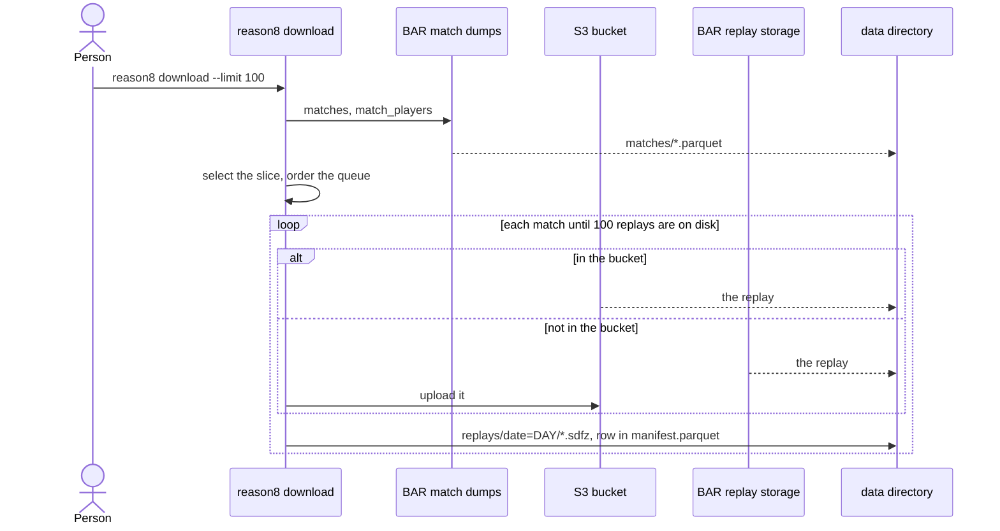
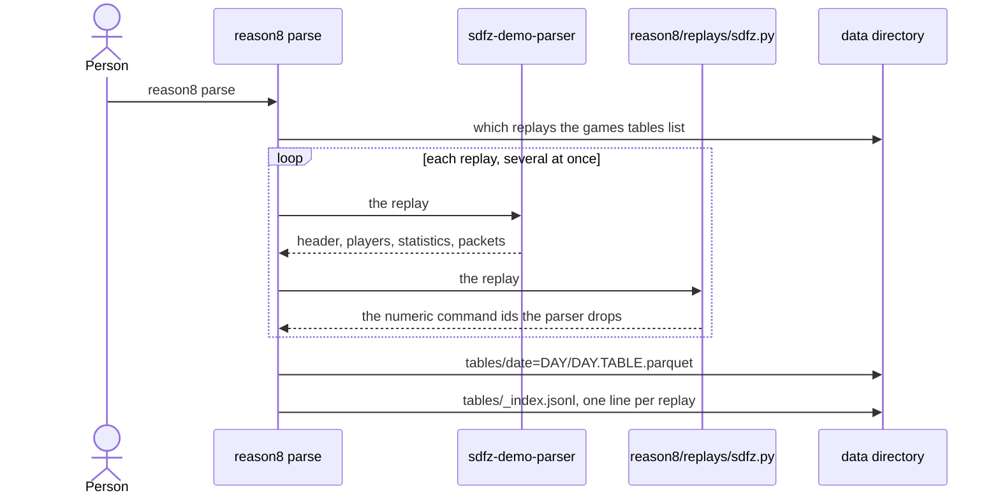
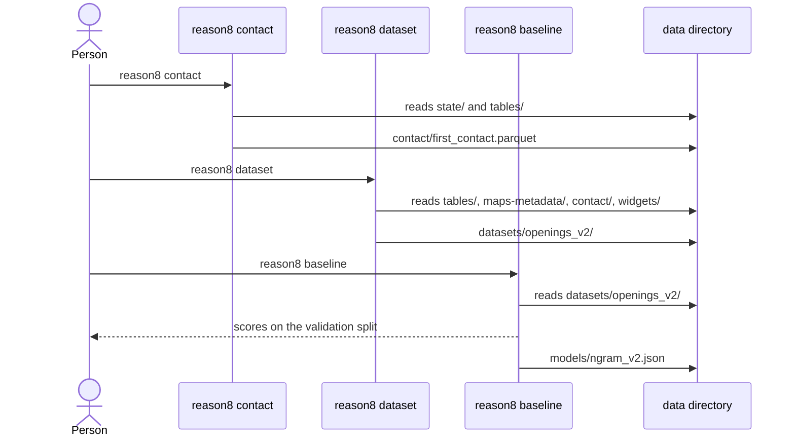
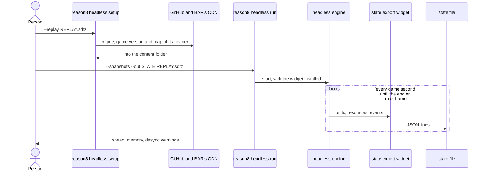
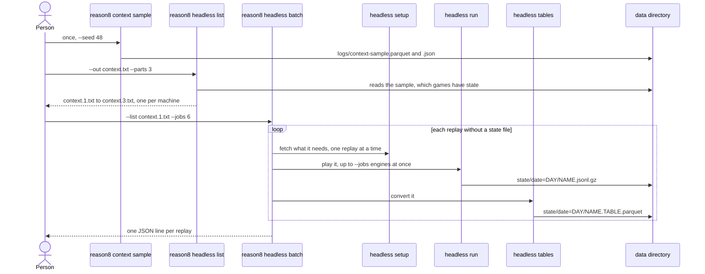
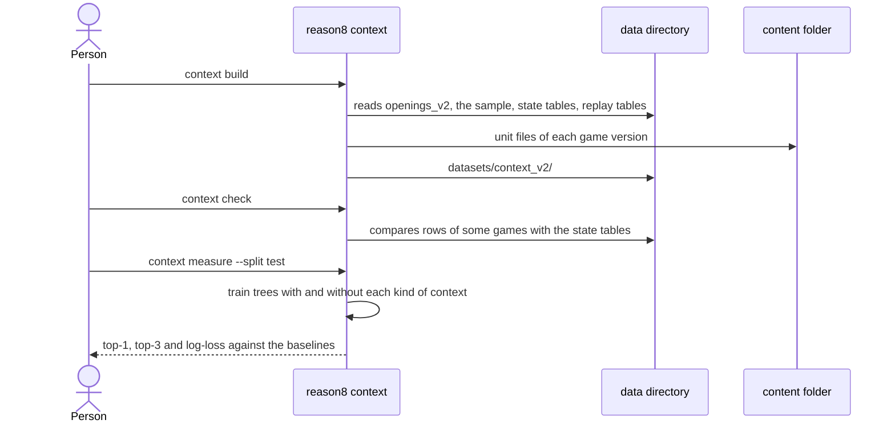
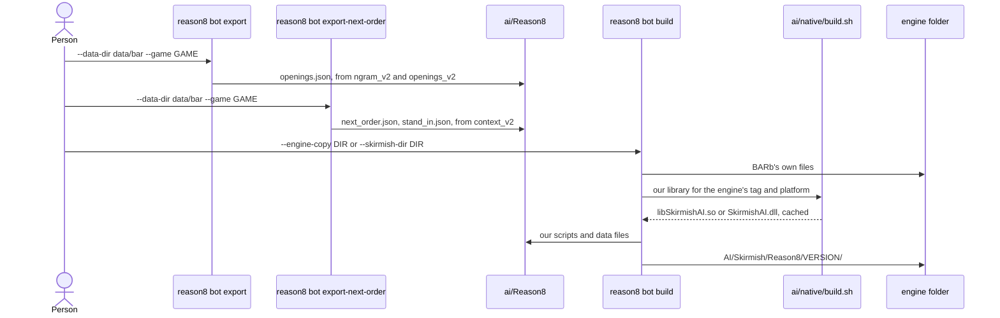
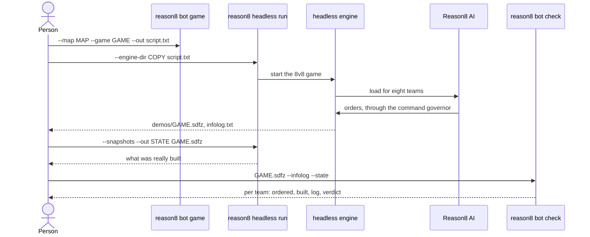
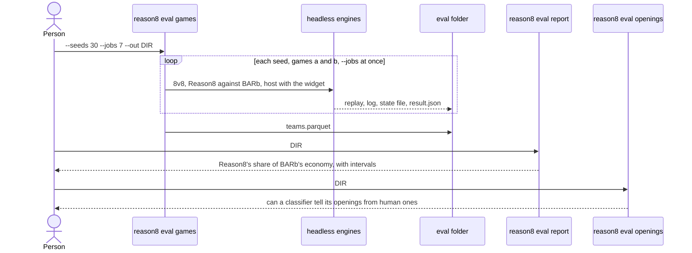
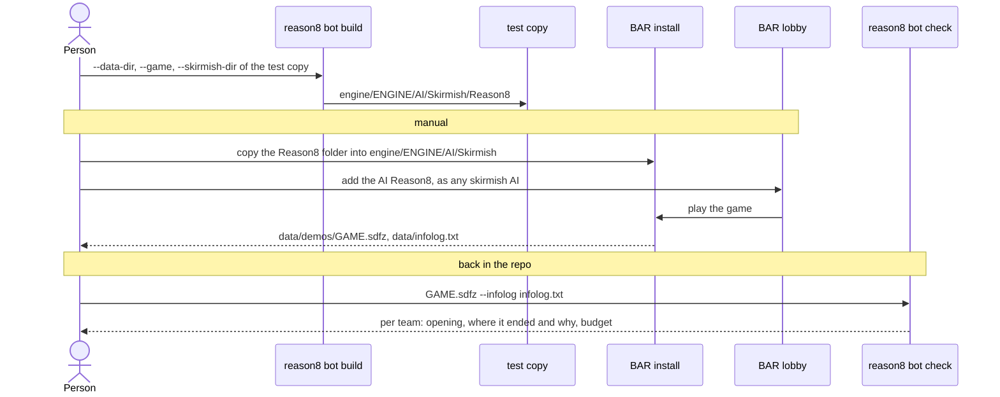

# Workflows

The usual tasks, one section each: when you do it, what happens between the
parts, and the commands. The overview of how they fit together is in the
[README](../../README.md#how-the-model-is-built); every command has more in
`uv run reason8 <command> --help`.

The parts that appear in the diagrams:

`reason8`
: The command line of this repo (`reason8/cli.py`), run as
  `uv run reason8 <command>`.

The data directory
: `data/` in the repo, or `$REASON8_DATA_DIR`: replays, tables, state files,
  datasets and models. Git-ignored; replays hold players' names. The layout is
  in [`dataset.md`](dataset.md#data-layout).

The content folder
: `data/bar` in the examples: engines, game versions and maps for the headless
  engine, fetched by `reason8 headless setup`.

The headless engine
: `spring-headless`, the game engine without graphics, run by
  `reason8 headless run` and the commands built on it.

The state export widget
: `reason8/headless/widgets/reason8_state_export.lua`, installed into every
  headless run: a spectator that writes the game state to a file.

BARb and our library
: BARb is the AI that ships with BAR. The Reason8 AI is BARb's library, built
  by us with a command governor, the model's next orders and live state
  (`ai/native`), and BARb's scripts with our hooks (`ai/Reason8`). See
  [`in-game.md`](in-game.md).

## Getting replays and match data

Once on a new machine, and whenever the slice should grow. With access to the
private S3 bucket, pull what others downloaded and parsed instead of asking
BAR's servers again. `reason8 download` takes the match dumps, selects the
training slice ([`dataset.md`](dataset.md)) and fetches its replays one at a
time, about one request a second.



Without a bucket configured the downloader only asks BAR's replay storage. A
replay already on disk is never asked for again.

```sh
uv run reason8 download --limit 100 --dry-run   # the first 100 of the queue
uv run reason8 download --limit 100             # and download them

# with the bucket
export REASON8_S3_URI=s3://<bucket>
uv run reason8 sync pull replays tables matches # bucket -> data/
uv run reason8 sync push                        # data/ -> bucket

uv run reason8 maps fetch                       # once: BAR's pinned map list
```

## Parsing replays into tables

After downloading replays. A replay file stores the players' commands; parsing
turns them into Parquet tables (commands, selections, events, chat, start
picks, statistics, players, games and more) that every later pass reads
([`replay-format.md`](replay-format.md)). Replays parsed before are skipped.



```sh
tools/fetch-parser.sh                                    # once: the pinned parser
uv run reason8 parse                                     # every new replay
uv run reason8 parse --since 2026-11-01 --until 2026-11-08   # some days
uv run reason8 widgets                                   # players' user widgets
uv run reason8 header REPLAY.sdfz                        # engine, game, map
```

`reason8 widgets` reads the widgets each player had installed straight from
the replays, into `data/widgets/`; the opening dataset flags openings played
with build-automation widgets from it.

## Building the opening dataset

After parsing, and again whenever more replays are parsed or the definition of
an opening changes. Every build order of a player's opening becomes a row,
split by game into train, validation and test
([`openings-dataset.md`](openings-dataset.md)). Where an opening ends comes
from first contact, measured on re-simulated games (next section) where there
are some. The counting baselines are trained and scored on it.



```sh
uv run reason8 contact                  # re-simulated games -> first contact
uv run reason8 dataset                  # -> data/datasets/openings_v2/
uv run reason8 dataset --stats          # the tables of openings-dataset.md
uv run reason8 baseline                 # train, score validation, save
uv run reason8 baseline --split test    # the numbers of results.md
```

## Re-simulating replays for game state

A replay does not hold the state of the game: units, resources, what each team
saw. Playing it again in the headless engine with the state export widget
recovers it
([ADR 0010](../decisions/0010-re-simulate-replays-headlessly-for-game-state.md),
[`state-extraction.md`](../research/state-extraction.md)). Do it for one
replay to look at a game, and in a batch for first contact, reaction times and
the decision table. Only the exact engine and game version of the replay play
it back correctly, so they are fetched first.

### One replay



```sh
uv run reason8 headless setup --data-dir data/bar --replay REPLAY.sdfz
uv run reason8 headless run --data-dir data/bar --threads 1 --snapshots \
    --out X.jsonl REPLAY.sdfz
uv run reason8 headless state X.jsonl --builds   # sizes, counts, first builds
uv run reason8 headless tables X.jsonl           # Parquet tables next to it
```

A run that reports a desync was not re-simulated correctly and exits non-zero.

### A batch

A batch plays the games of a sample: by default the context sample, the games
the decision table is built from. `reason8 context sample` draws it once, with
a seed, and `reason8 headless list` writes the replays of its games that have
no state file yet, in parts when several machines share the work. The parts do
not overlap, so no two machines play the same game.



```sh
uv run reason8 context sample          # once: -> data/logs/context-sample.parquet
uv run reason8 headless list --out data/workers/context.txt --weights 6,4,3
# on each machine, its part: the first 10 game minutes, 6 engines at once
uv run reason8 headless batch --data-dir data/bar --out-dir data/state \
    --jobs 6 --max-frame 18000 --list data/workers/context.1.txt
uv run reason8 headless tables --state-dir data/state --check
```

`context sample` writes, next to the sample, how it was drawn: the rule, the
seed, the counts per map and the source dataset; it does not overwrite a
sample without `--force`. Each list starts with `#` lines naming the sample it
came from, which the batch skips. An engine needs 5 to 6 GB of memory, which
decides `--jobs`. A batch can be stopped and run again: replays with a state
file are skipped. To share out what is left, write the lists again.

The tables of a game, one file each, described in
`reason8 headless tables --help`: `game`, `resources`, `events`, `units`,
`hits`, `damage`, `features`, `reclaim`, `work` and `visibility`.

## Building the decision table and measuring models on it

After a batch of the context sample has played. The decision table joins every
order players gave their builders in their openings with the state of the game
just before it ([`context-dataset.md`](context-dataset.md),
[ADR 0018](../decisions/0018-learn-from-orders-joined-with-the-state-before-them.md)).
It grows as more games of the sample are re-simulated, so build it again after
a batch. Its manifest says which sample it was built from and how that was
drawn.



```sh
uv run reason8 context build                  # -> data/datasets/context_v2/
uv run reason8 context check                  # the join, on 20 games
uv run reason8 context measure                # validation
uv run reason8 context measure --split test   # the numbers of context.md
```

Training the learned model of
[ADR 0019](../decisions/0019-first-model-decides-each-builders-next-order.md)
on this table, and scoring it, is being built and has no command on `main`
yet.

## Exporting for the bot and building it

After a new model or dataset, and whenever the game version the bot plays
changes. The exports write data files into `ai/Reason8`; the build puts the AI
folder together from BARb, our library and those files, and installs it into a
headless engine or a BAR install ([`in-game.md`](in-game.md#what-we-built)).



`reason8 bot export` reads the reaction times of `reason8 analysis reactions`
too (`data/reactions/idle.parquet`). `stand_in.json` is a temporary stand-in
for the learned model: the bot uses it only with the AI option
`builder_orders=model`, and it goes when the learned model is in. The game's
BARb scripts come from the game package in the content folder. The first
library build takes 5 to 7 minutes; later builds reuse it until `ai/native`
changes.

```sh
uv run reason8 bot export --data-dir data/bar \
    --game "Beyond All Reason test-32018-ad135b9"
uv run reason8 bot export-next-order --data-dir data/bar \
    --game "Beyond All Reason test-32018-ad135b9"

# Linux: a copy of the engine with Reason8 inside, for headless games
uv run reason8 bot build --data-dir data/bar \
    --game "Beyond All Reason test-32018-ad135b9" \
    --engine-copy data/bar/engine-variants/reason8

# Windows, from WSL: the same with a content folder on the Windows drive;
# the library is built as SkirmishAI.dll because the engine is a Windows one
uv run reason8 bot build --data-dir /mnt/c/<folder>/bar \
    --game "Beyond All Reason test-32018-ad135b9" \
    --skirmish-dir /mnt/c/<folder>/bar/engine/recoil_2026.09.03/AI/Skirmish
```

`--limits-only` builds `BARbLimited`, stock BARb under Reason8's limits and
without openings; `--library stock` keeps the engine's own library.

## Running a headless game and checking it

After every build, to see that the bot loads and plays. A failure is silent in
the game: a team whose AI did not load stands still. `reason8 bot check` reads
the replay, the engine log and the state to say what happened
([`in-game.md`](in-game.md#how-to-run-it)).



```sh
uv run reason8 bot game --map "Supreme Isthmus v2.1" \
    --game "Beyond All Reason test-32018-ad135b9" --minutes 6 \
    --out data/runs/team-isthmus/script.txt
# with the model's next orders: add --ai-option builder_orders=model
uv run reason8 headless run --data-dir data/bar --threads 2 \
    --engine-dir data/bar/engine-variants/reason8 \
    --run-dir data/runs/team-isthmus --timeout 1500 \
    data/runs/team-isthmus/script.txt
uv run reason8 headless run --data-dir data/bar --threads 1 --snapshots \
    --max-frame 7500 --out data/runs/team-isthmus.state.jsonl \
    data/runs/team-isthmus/demos/*.sdfz
uv run reason8 bot check data/runs/team-isthmus/demos/*.sdfz \
    --infolog data/runs/team-isthmus/infolog.txt \
    --state data/runs/team-isthmus.state.jsonl
```

`reason8 bot check` exits non-zero unless the AI loaded without errors, its
command governor kept the budget and every team played its opening, or had its
orders decided by the model.

## Paired evaluation games

To judge a change of the bot where it counts: its economy at 4:00 and at first
contact against stock BARb on the same spots
([ADR 0003](../decisions/0003-define-success-as-in-game-measures.md),
[`evaluation.md`](evaluation.md)). Each seed is played twice with the sides
swapped. The A/A test, stock BARb against itself, sets how many seeds a
comparison needs.



```sh
# once: the AI in a copy of the engine (previous sections)
uv run reason8 eval games --data-dir data/bar \
    --game "Beyond All Reason test-32018-ad135b9" \
    --engine-dir data/bar/engine-variants/reason8 \
    --seeds 30 --jobs 7 --out data/eval/reason8-vs-barb
uv run reason8 eval report data/eval/reason8-vs-barb
uv run reason8 eval openings data/eval/reason8-vs-barb
# the A/A test
uv run reason8 eval games ... --ai BARb --out data/eval/barb-vs-barb
```

A game with a `result.json` is not played again, so an interrupted run goes on
with the same command. A game needs about 6 GB of memory; 60 games take about
20 minutes on one machine.

## Playing a lobby game with the bot

To play with the bot yourself, in the BAR client, and look at the game
afterwards. Reason8 has played real-time 4v4 lobby games in the Windows client
([`in-game.md`](in-game.md#installing-it-in-a-real-game)). Our tools never
write into the real install: the bot is built into a test copy of the game's
data with the same engine and game version, and copied into the install by
hand.



```sh
# from WSL, for the Windows client: the library is built as SkirmishAI.dll
uv run reason8 bot build --data-dir "/mnt/c/<test copy>/data" \
    --game "<the game version the lobby plays>" \
    --skirmish-dir "/mnt/c/<test copy>/data/engine/<engine>/AI/Skirmish"
# by hand: copy <test copy>/data/engine/<engine>/AI/Skirmish/Reason8
# into <BAR install>/data/engine/<engine>/AI/Skirmish/

# after the game: what the bot did, from its replay and the engine's log
uv run reason8 bot check "<BAR install>/data/demos/GAME.sdfz" \
    --infolog "<BAR install>/data/infolog.txt"
```

`reason8 bot check` gives, per Reason8 team, the opening it played, where the
opening ended and why, whether the orders matched it, and the command
governor's budget. To compare with what was really built, play the replay
again headlessly (`reason8 headless setup --replay`, then
`reason8 headless run --snapshots --out STATE`) and add `--state STATE`.

The lobby sends the short name and no version, so the engine loads the highest
version installed: keep one. An engine update replaces the engine folder and
the AI in it, and the library must match the engine, so build and copy again
after an update. The AI option `builder_orders` (Opening or Model) chooses who
decides the builders' orders in the opening; Model uses the temporary
stand-in.
